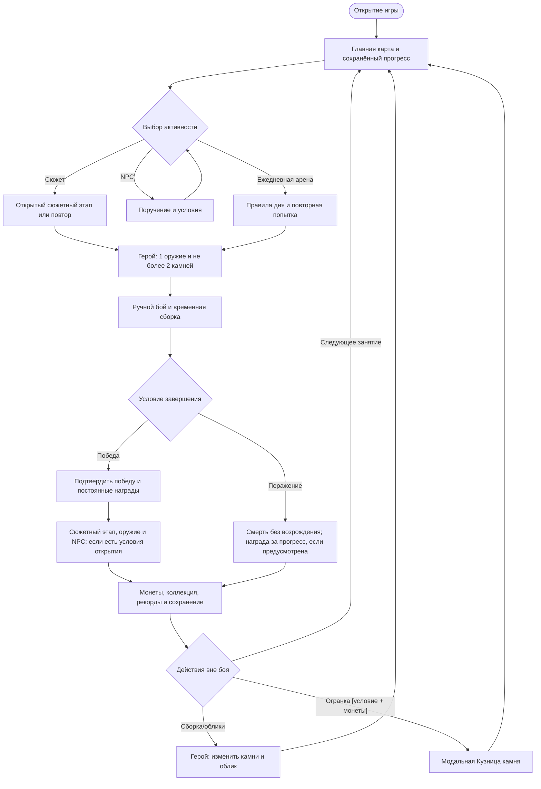
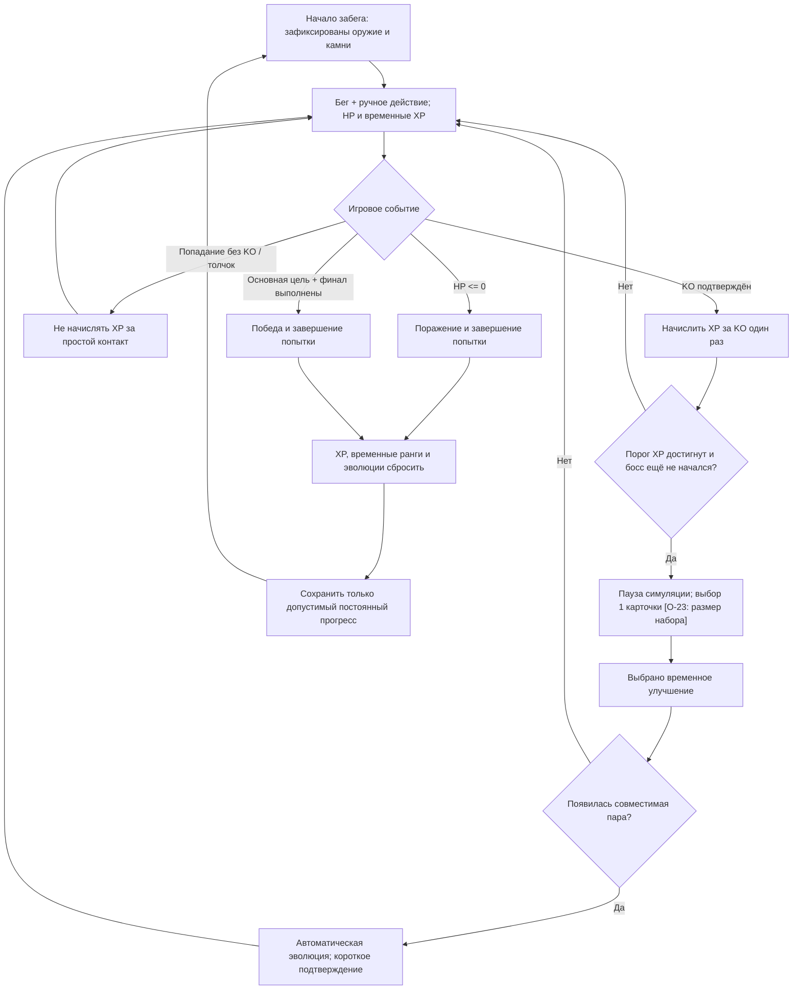
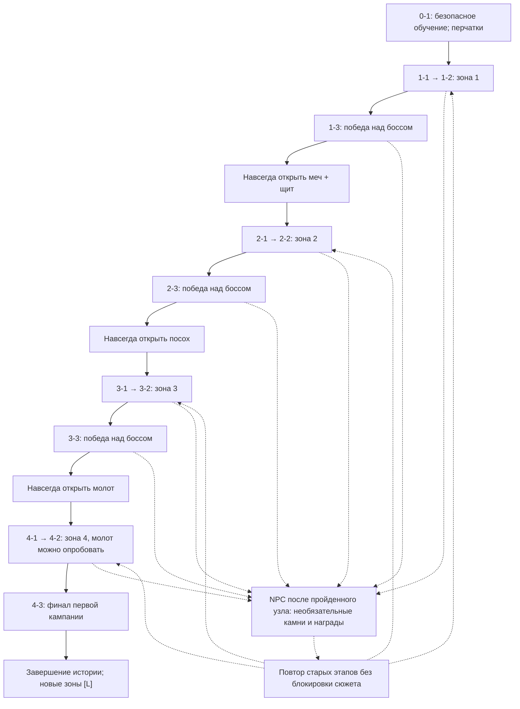
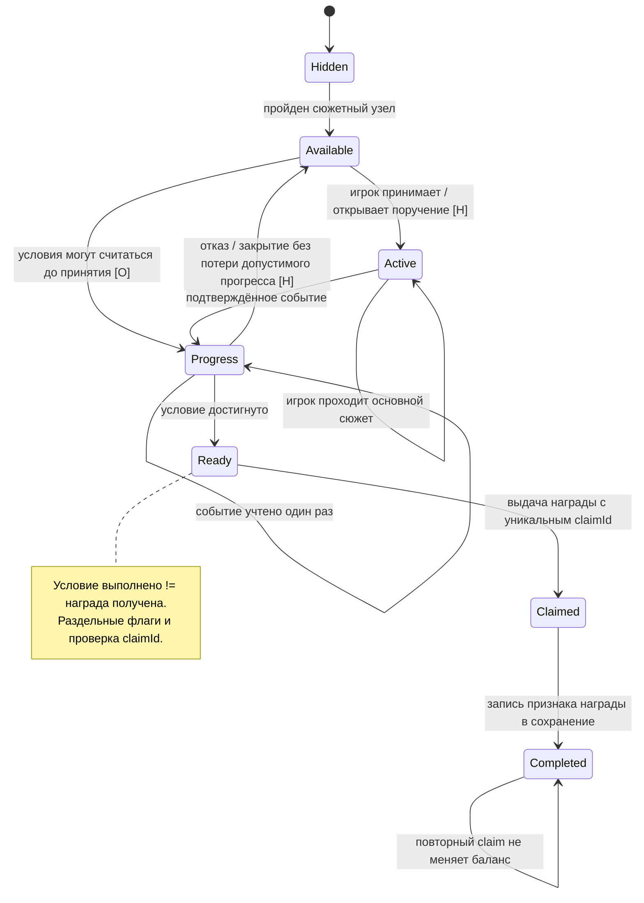
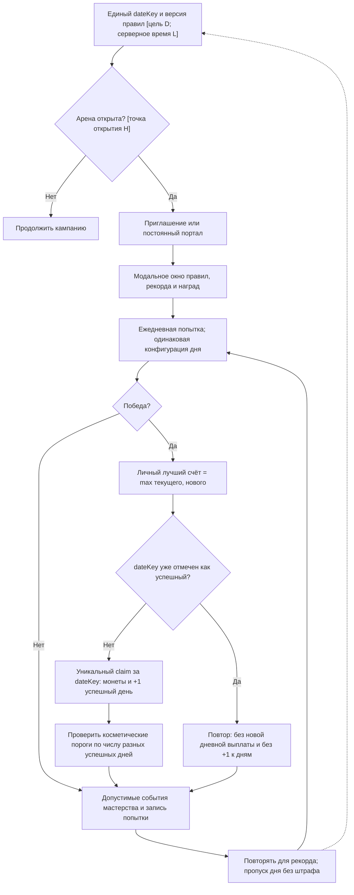
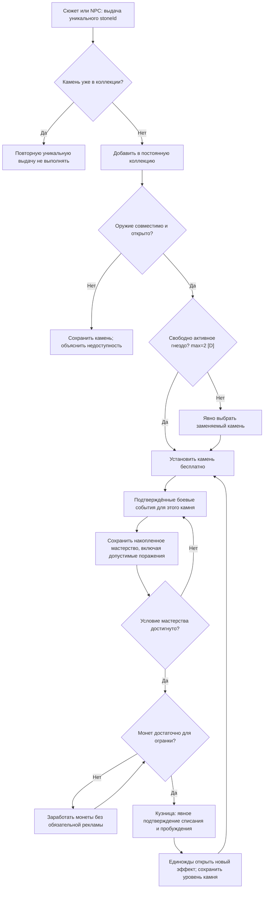
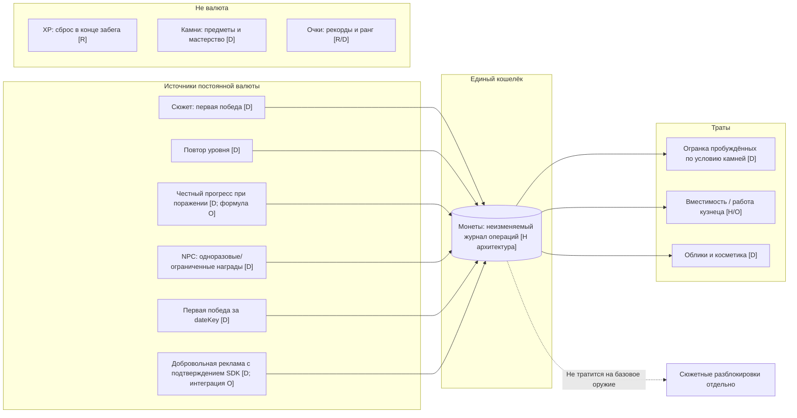
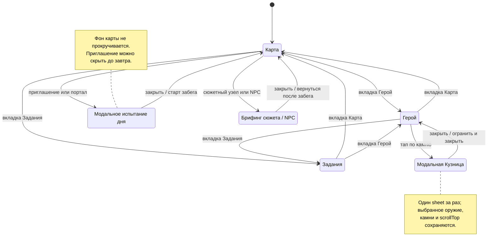

# PUNCH ’N’ GO — дизайн игры

Целевой дизайн, правила игры и границы первого релиза. [Статусы решений](README.md#statuses) действуют для текста, таблиц и диаграмм.

[Указатель проекта](README.md)

## Общее видение

### Elevator pitch **[D]**

**PUNCH ’N’ GO** (рабочее название; нейминг отложен) — вертикальная мобильная first-person runner × beat ’em up в юмористическом фэнтези. Герой автоматически движется по трёхполосной дороге, вручную атакует и контратакует. Старт — **магические перчатки**; после побед над боссами открываются меч со щитом, посох и двуручный молот. В кампании **4 зоны по 3 сюжетных этапа (12) плюс обучение 0-1**. За дополнительными заданиями NPC скрываются уникальные камни оружия, косметика, монеты и истории. Камни постоянно меняют поведение оружия и подготавливают сборку; XP и эволюции меняют конкретный забег. После зоны 1 доступно ежедневное испытание [H: момент открытия] для повторяемого контента.

### Столпы игры **[D]**

1. **Ручной бой, короткая сессия.** Нет автоматического сражения. Тап, удержание, три направления свайпов, контратака и физика столкновений требуют решения игрока.
2. **Одна схема жестов — четыре стиля оружия.** Экипировка меняется вне забега; приёмы и темп ощутимо различаются.
3. **Разнообразие вместо численного роста.** Оружейные камни дают новые способы действовать. Не строить прогрессию вокруг повторяющихся +2% HP/урона/XP.
4. **Три слоя прогрессии.** Сюжет открывает оружие; постоянные камни формируют подготовку; временные улучшения и эволюции раскрываются в забеге.
5. **Содержательные побочные активности.** NPC предлагает новую награду/историю/путь мастерства, а не только очередные десять монет.
6. **Повторяемость без наказания.** Ежедневный режим и рекорды дополняют кампанию; пропуск дня не отнимает прогресс и уникальные боевые возможности.
7. **Прежде всего читаемость.** Не превращать короткий мобильный бой в визуальную перегрузку VFX, лута и рекламы.

### Не-цели **[D]**

Нет выносливости, контрольных точек/возрождений после смерти, 3★ или звёздного барьера прогресса, обязательных NPC-поручений, обязательного ежедневного входа, платного открытия сюжетных видов оружия, отдельного постоянного экрана Кузницы, случайных платных сундуков или принудительной рекламы внутри боя. В первом публичном релизе — **free-to-play без внутриигровых покупок (IAP)** [D как целевая бизнес-модель; договоры с рекламными площадками требуют проверки].

### Мир и визуал **[D/O]**

Цель — выразительное, минималистичное мультяшное фэнтези, цветные эффекты, юмор и интерактивная вертикально прокручиваемая карта мира. Парк и хулиганы в текущем боевом коде — временный стенд [R]. Каноническая история, названия локаций/врагов, точная стилистика арта и название продукта остаются [O]. Черновая сюжетная арка «Тайна Чёрного Колокола» — [H].

## Игровые циклы

### Момент-к-моменту **[R]**

`Автоматический бег → выбор полосы и угрозы → ручной удар / свайп / удержание / контратака → физика столкновения → XP и очки → новая ситуация`.

### Один забег **[R; сюжетные цели D]**

`Выбор оружия и двух экипированных камней (будущая система) → старт этапа → волны/события → XP и выбор 1 из 3 → временная эволюция при сборе пары → босс/цель → победа или поражение → результат`. [Длительность и параметры этапов](BALANCE.md#levels). Смерть завершает текущий забег.

### Сюжетный цикл **[D]**

`Карта → уровень → сюжетная цель → забег → результат и монеты → открытие следующего этапа → NPC и поручения на карте → новое оружие после босса → Герой: сборка камней и обликов → следующий забег`.

#### Диаграмма 1. Основной сюжетный игровой цикл **[D]**

Эта схема показывает последовательность решений между забегами. Временные улучшения внутри забега раскрыты отдельно в диаграмме 2.

**Правило:** смерть не отменяет уже открытые этапы и допустимый накопительный прогресс NPC. Состав конкретных наград — [H/O].

### Постоянная экономика и мастерство **[D]**

`Забеги и сюжет/поручения/ежедневное испытание → монеты и/или магические камни → задания мастерства на камнях → огранка за монеты после достижения условия → новые действия оружия → изменение сборки перед следующим забегом`.

Одна основная постоянная валюта — **монеты [D]**; магические камни — **коллекционные предметы, не расходуемая премиальная валюта**. XP, временные улучшения и эволюции сбрасываются после попытки. Монеты не покупают базовые сюжетные оружия. Рекламное видео — необязательный ускоритель накопления монет.

### Ежедневная петля **[D]**

`Новый игровой день → компактное приглашение на карте / постоянный портал → модальное описание правил → короткий ежедневный забег → разовая награда за первую победу, рекорд и прогресс камней → повтор ради результата → накопительная косметика [O-19: единица зачёта]`.

В прототипе онлайн-рейтинги имитируются; реальный серверный рейтинг — отдельная будущая фаза [L/O].

## Камера, маршрут и движение

### Вид и структура дороги **[R]**

- Вертикальная ориентация и **первое лицо**: внизу экрана видны две руки/кулака героя.
- **Три полосы движения**: левая, центральная, правая.
- Автоматический бег вперёд; герой не останавливается специально ради столкновения с группами.
- Повороты дороги создают псевдо-3D перспективу: положение дорожного центра зависит от продвижения вдоль маршрута.
- Цели и столкновения определяются в логических координатах мира; картинка камеры не заменяет физику.

### Скорость **[R]**

Отдельный тап даёт короткий ограниченный рывок даже при промахе. Удержание при серии ударов снижает базовую скорость, которая восстанавливается после отпускания. [Параметры движения](BALANCE.md#combat).

### Перепады высот и расширенный мир **[H; L]**

Исследован референс с дорогой по холмам и многослойным задним планом. Приоритетные возможные улучшения: дальний ориентир (замок/башня), небо, дальние горы, деревня/лес среднего плана, крупные боковые декорации, плавная смена участков. **Полноценный вертикальный рельеф `roadHeight(z)` не утверждён как обязательный для MVP**. Он требует проверки перспективы, камеры, окклюзии и читаемости противников. Текущая дорога реализует главным образом **горизонтальную кривизну [R]**.

---

## Управление и семейства оружия

### Единый словарь жестов **[D]**

Герой движется вперёд автоматически. Имеются три полосы. В любом оружии: тап — основная атака; удержание — отличительное длительное действие; горизонтальный свайп — перемещение на одну полосу и связанный приём; свайп вверх — продвигающий атакующий приём; свайп вниз — мощный приём контроля. Свайп не должен срабатывать как тап. Контратака сохраняет отдельный точный тап в предупредительном окне (красный → жёлтый → прицельный идеальный момент).

**Одно оружие выбирается до забега; смены в бою нет [D].** В MVP вся реализованная система перчаток остаётся эталоном, а правила для прочих видов — целевой дизайн с гипотезами конкретных эффектов [D/H].

| Ввод | Магические перчатки [R] | Меч + щит [D/H] | Посох [D/H] | Двуручный молот [D/H] |
|---|---|---|---|---|
| Тап | Прямой удар + короткий рывок | Выпад/рубящий удар мечом | Прицельный магический снаряд без сближения | Тяжёлый удар с длинным замахом |
| Удержание | Серия ударов с замедлением бега | Поднятый фронтальный блок щитом | Заряд заклинания, выпуск при отпускании | Заряд усиленного удара, выпуск при отпускании |
| Влево | Перестроение + боковой удар | Перестроение + удар клинком | Перестроение + боковой магический выстрел | Перестроение + широкий замах |
| Вправо | Перестроение + боковой удар | Перестроение + толчок щитом | Перестроение + боковой магический выстрел | Перестроение + широкий замах |
| Вверх | Супер-рывок-таран | Щитовой натиск | Магический рывок | Продвигающий таран молотом |
| Вниз | Пружинный апперкот | Восходящий удар мечом | Воздушный вихрь/подбрасывание | Удар по земле с ограниченной волной |
| Тап в жёлтое окно | Контрудар кулаком | Парирование + ответ мечом | Магическое парирование | Встречный удар молотом |

Боковые приёмы меча «влево клинком / вправо щитом» и формат боковых выстрелов посоха **[H]** требуют проверки на крайних полосах и мобильных тестах: направление перестроения не должно лишать игрока жизненно нужной защиты.

### Базовые механики перчаток **[R]**

Тап даёт одиночный удар и начальный рывок. При удержании первый принятый удар полноценный, а последующие джебы слабее и идут без нового рывка. Режим сохраняет правила отбрасывания и цепного урона. Для контратаки игрок отпускает удержание и делает отдельный тап в жёлтом окне. Телеграфы угроз видны поверх эффектов джеба. [Боевые параметры](BALANCE.md#combat).

### Характеристики оружия **[D/H]**

| Оружие | Урон за попадание | Защита | Темп | Роль |
|---|---|---|---|---|
| Перчатки [R/D] | Низкий | Низкая | Очень быстрый | Комбо, физические цепочки, мобильность |
| Меч и щит [D/H] | Средний | Высокая | Средний | Блок, парирование, надёжность |
| Посох [D/H] | Средний | Низкая | Средний | Дистанция, выбор цели, контроль |
| Молот [D/H] | Высокий | Средняя | Медленный | Мощные отбрасывания, точный тайминг |

Посох не должен совмещать дальнюю атаку с высокой бесплатной защитой. Молот не должен наносить «средний» урон при медленной атаке: тяжесть должна окупаться. Все четыре вида оружия обязаны проходить все обязательные сюжетные задачи без эксклюзивных механических ключей [D].

### Блок, заряд и контратака **[D/H]**

- Щит при удержании частично поглощает фронтальный урон ([пробное значение](BALANCE.md#combat) [H]), но лишает игрока атак на время блока, не даёт неуязвимость и **не** гарантирует прерывание опасного выпада Бульдога.
- **Только своевременная ручная контратака** прерывает опасный выпад босса. Для разных оружий меняются визуал/анимация, но не требование точного ввода.
- Для посоха и молота удержание — подготовка заряда, выпуск на отпускании. Заряд и свайп не должны случайно запускать другие действия. Длительности, отмена заряда при угрозе и риск получения урона проверяются плейтестами [O].
- Приёмы, перемещающие героя, не заменяют трёхполосную навигацию. Дальность выстрелов, частота, автоматическое прицеливание и столкновение с геометрией — [O].

### Политика освоения ввода **[D]**

Основные жесты обучаются один раз на 0-1 с перчатками. При первом получении нового оружия показывается короткая демонстрация именно его уникального удержания и специальных жестов. Пользователь может повторить подсказки; повторный обязательный длинный туториал не нужен.

## Боевая система

### Прямой удар **[R]**

- Чередование левой и правой руки.
- Базовый урон допускает усиления во время забега.
- Попадание в ближайшую корректную цель по логической зоне поражения.
- При успешном ударе возможны отбрасывание и рикошеты; при промахе короткий рывок от одиночного тапа сохраняется.
- Улучшения могут сокращать интервал между ударами до предела текущего билда.

### Боковой удар и перемещение **[R]**

Свайп перемещает героя на соседнюю полосу и может нанести удар не более чем одной цели в полосе выхода и одной в полосе входа. Боковой удар не является автоматической массовой атакой по всей сцене. Переход ограничен тремя полосами и имеет анимацию движения.

### Контратака **[R; D для целевой роли]**

- Противник заранее сигнализирует об активной атаке **красным**, затем о коротком окне ручной контратаки **жёлтым**.
- Игрок нажимает в нужный момент, чтобы прервать опасный выпад и нанести усиленный удар.
- Внутри окна выделен ещё более точный **идеальный** тайминг.
- Окна ввода, урон и оглушение заданы в [параметрах боя](BALANCE.md#combat).
- Во время обычной серии удержанием атака не превращается автоматически в контратаку; нужен отдельный точный ввод.
- Контратака сохраняет особую ценность в бою с боссом: **только она гарантированно прерывает его опасную атаку**. Прямые удары и спецприёмы сами по себе этого не делают.

### Супер-рывок: непрерывный таран **[R]**

**Роль:** быстрое перемещение и контроль расположения противников, **не** бесплатный массовый нокаут.

1. Свайп вверх активирует таран с фазами входа, движения и восстановления.
2. **Только первый прямой контакт за активацию** наносит [часть базового урона](BALANCE.md#combat). При нокауте действуют обычные правила XP.
3. Выживший враг помещается **перед героем** и толкается вперёд. Следующие враги, которых догоняет герой или цепочка, присоединяются **без дополнительного урона**.
4. **Нет искусственного лимита числа участников**, замедления от массы, автоматического оглушения и финального выброса.
5. После выдвижения кулаков снова доступны тап, удержание и боковые удары/перестроения. Прямые удары наносят обычный урон; нокаутированный участник освобождает место следующему. Боковой удар может выбросить цель из цепочки в обычный полёт.
6. Базовая цепочка располагается с зазорами. Она не должна перекрывать весь обзор.
7. После окончания супер-рывка противники **остаются живыми впереди**, без бесплатного урона/полёта/оглушения; возвращаются к AI и стандартным предупреждениям об атаках.
8. Бульдог не может быть включён в цепочку: он служит **непроходимым упором**. Рывок не позволяет просто пролететь мимо босса; таймер способности продолжает идти.
9. «Ударная волна» расширяет захват до соседних полос; электричество — отдельный эффект от первого удара при наличии улучшения. Простое толкание не начисляет комбо, XP или урон.

### Пружинный апперкот **[R]**

**Роль:** прицельный сильный восходящий удар с коротким рывком и физическим запуском одного противника; не замена контратаке или тарану.

**Фазы одного приёма:**

| Фаза | Смысл |
|---|---|
| Сжатие | Резкое торможение и визуальное оседание героя |
| Выброс | Короткое ускорение вперёд одновременно с ударом |
| Возврат | Кулак и скорость возвращаются к обычным значениям |

Точное поведение:

- Сжатие вычитает фиксированную величину из продольной скорости. При отрицательной скорости герой может кратко отступить в пределах маршрута.
- Выброс и затухание добавляют продвижение. У апперкота собственная дальность и растущий фронт удара. [Числа фаз и кинематики](BALANCE.md#combat).
- Проверка попадания происходит **по активной траектории**, а не единственным моментальным поиском; прямой урон получает **только первая валидная цель и только один раз**.
- Урон и отбрасывание усилены, сохраняются подъём в воздух, цепные столкновения/рикошеты и чередование рук независимо от прямых ударов.
- Полупрозрачная **восходящая дуга импульса** отображает реальную зону удара, но **сама не является дополнительной площадной атакой**. Допустимы небольшая пыль, движение камеры, шлейф.
- **Нет дополнительной защиты [D: выбран вариант A]**: ни неуязвимости, ни уменьшения урона, ни автоматического прерывания атак. Существующие общие правила получения урона остаются.
- Следующий спецприём доступен по истечении общей перезарядки.
- Попадание по Бульдогу наносит урон, **но не прерывает его опасный выпад**.

### Столкновения и цепные реакции **[R]**

- Физически отброшенный враг становится снарядом, способным задеть другую цель.
- Настоящее цепное столкновение наносит урон, даёт очки и передаёт импульс.
- [Лимиты передач и целей](BALANCE.md#combat) ограничивают цепную реакцию. Число участников тарана отдельным лимитом не ограничено.
- Боковой контакт героя с врагом наносит контактный урон (если герой не защищён существующим коротким периодом после повреждения) и отбрасывает противника в сторону. Само касание/передача толчка корпусом не является цепной атакой и не даёт наград.
- Нокаут фиксируется по достижении **0 HP**; опыт и обычные очки начисляются **только в момент нокаута**, один раз.
- Враг, выбитый апперкотом, может столкнуться с другой целью по своей траектории и высоте; спецулучшения могут менять дальнейшее распространение.

### Основные показатели героя **[R]**

- В начале попытки герой получает максимальное HP.
- **Выносливости нет**; отдельного блока для её восстановления нет.
- При получении урона комбо сбрасывается, на ограниченный период действует стандартная неуязвимость.
- При **0 HP** текущая попытка сразу завершается; нет контрольных точек или возрождения.

---

### Варианты ударов и анимационные контракты разных оружий **[D/H]**

Анимация каждой атаки строится из логических фаз: **подготовка → замах/заряд → активный контакт или выпуск снаряда → отдача → возврат**. Тайминг коллизии должен совпадать с изображением; иллюстрация оружия не расширяет хитбокс сама по себе.

| Оружие | Тап/серия | Удержание | Горизонтальный | Свайп вверх | Свайп вниз | Контратака |
|---|---|---|---|---|---|---|
| Перчатки [R] | Попеременные кулаки, лёгкие джебы | Цикл ускоряемых джебов | Боковой замах | Два вытянутых кулака, линии скорости, непрерывная цепочка живых врагов | Сжатие/короткое отступление, восходящий выброс одной рукой | Резкий встречный удар и усиленная вспышка |
| Меч+щит [H] | Рубящий/колющий удар левой рукой | Подъём щита справа и состояние блока | Слева клинок / справа удар щитом | Низкий щитовой натиск | Подсекающий/восходящий взмах мечом | Парирование щитом + быстрый ответ клинком |
| Посох [H] | Наведение и выстрел из наконечника | Накопление энергии на двух руках, выпуск снаряда | Смещение посоха и выстрел в новую полосу | Световой продвигающий рывок | Восходящий вихрь | Отражающий магический импульс |
| Молот [H] | Длинный замах/тяжёлый контакт | Заряд с подъёмом над головой | Размашистый взмах по траектории перестроения | Натиск с молотом впереди | Удар о землю и локальная ударная волна | Встречный удар рукоятью/головкой |

Сильное ощущение массы достигается замахом, физикой, звуком, короткой **визуальной** ударной паузой и отбрасыванием, а не обязательной остановкой логики AI. Контратаки/телеграфы всегда читаются поверх VFX. Анимации при эволюциях преимущественно переиспользуются: меняются следы, цвет, частицы и поведение попаданий, а не перерисовываются все кадры. Точные число кадров, тайминги и форматы ассетов — [O].

### Запрет на нарушения физической модели **[D]**

Эволюции и оружейные спецприёмы не делают захват живой цепочки тарана автоматически наносящим урон; прямой урон связан с подтверждённым попаданием или реальным столкновением. Лимит цепной физической реакции не равен отсутствию лимита участников супер-рывка. Ни одно оружие не отменяет исключительную роль контратаки в прерывании опасных атак Бульдога без отдельного утверждения нового босса.

## Противники и AI

### Роли врагов **[R; фэнтези-арт D]**

| Функциональный тип | Текущий временный персонаж | Дизайн поведения |
|---|---|---|
| Обычный | Хулиган (`thug`) | Держит свою полосу, базовая атака |
| Быстрый | Быстрый (`quick`) | Быстрее сближается, заранее обозначает перестроение |
| Тяжёлый | Громила (`brute`) | Медленнее, больше HP, сопротивляется отбрасыванию |
| Босс | Бульдог (`bulldog`) | Перехватывает игрока, атакует поперёк полос и отпрыгивает |

[Параметры врагов текущего билда](BALANCE.md#combat).

Будущие гоблины, каменные противники и другие существа — **целевая художественная замена**, а не окончательная таблица новых врагов. Типы, новые имена, анимации и способности фэнтезийных персонажей требуют отдельного дизайн-паспорта **[O]**.

### Правила телеграфов **[R]**

- Опасная атака предупреждается заранее и должна быть различима на экране мобильного устройства.
- Быстрый враг **предварительно обозначает боковой манёвр**, чтобы перестроение было честным.
- Не допускать плотных одновременных атак без времени на реакцию; директор столкновений управляет численностью и последовательностью волн.
- Враги в основном изображаются **анфас**, трёхчетвертный разворот — только по необходимости для уклонения/бокового движения **[D]**.

### Управляемая случайность групп **[R]**

Используется подготовленный набор построений: одиночный, пара, цепочка, диагональ, фланг, сопровождение, пересечение, плотная группа. Генератор учитывает стадию забега, текущую полосу героя, плотность, близость и читаемость. Сложность увеличивается по мере забега. Случайность воспроизводима по `seed` и не должна создавать заведомо нечестные ситуации.

---

## Босс «Бульдог»

### Базовый боевой паттерн **[R; сохранять в фэнтезийной версии D]**

- Приближается навстречу герою, может атаковать **независимо от текущей полосы** игрока.
- Телеграф → опасный выпад → отпрыгивание вперёд по дороге → повторный заход.
- **Любой успешный обычный удар наносит боссу урон**, но **не отменяет** предупреждённую опасную атаку.
- **Контратака** вовремя отменяет опасную атаку, отбрасывает и оглушает босса, позволяя догнать его рывками и нанести серию.
- Супер-рывок и апперкот также могут наносить урон, но **не являются способами отмены опасного выпада**.

### Фазы **[R]**

1. **Фаза I:** поединок один на один.
2. **Фаза II:** после [порога HP](BALANCE.md#combat) босс ускоряется. Периодически появляются обычные противники, которых можно отбросить в босса.
3. **Финальный нокаут:** автоматическое замедленное завершение и отбрасывание босса; затем экран победы.

**[O]** Художественная форма, характер, сюжетное происхождение, реплики, название в фэнтезийном мире и конкретные эффекты фаз.

---

## Внутризабеговая прогрессия (XP и временные улучшения)

### Получение XP и выбор улучшения **[R/D/O]**

- XP начисляется один раз за нокаут. Простой захват или толчок тараном XP не даёт.
- **Сценарий GDD v1.2.2:** при достижении порога до начала боя с Бульдогом симуляция ставится на паузу. После короткого вступления игрок выбирает одно из трёх улучшений. Формулировка сохранена в [TC-22](ACCEPTANCE.md#tc-22).
- **Фактическое поведение Park Run v2 [R]:** предложение содержит до трёх карточек. При пустом списке уровень повышается без окна. Подробности — в [реализации выдачи](TECH_SPEC.md#current-xp). Ожидаемое поведение целевой игры при исчерпании пула открыто в [O-23](README.md#o-23).
- Улучшения действуют до конца текущей попытки. С началом боя с Бульдогом выдача карточек прекращается.

### Карточки текущего билда **[R]**

[Каталог карточек и пороги XP](BALANCE.md#xp). Простой захват тараном не вызывает горение, цепное столкновение или комбо. «Второе дыхание» восстанавливает HP текущего забега. Другие обязательные лечащие предметы остаются открытым вопросом [O].

### Эволюции временных улучшений **[D; содержание комбинаций H]**

- **UX-правило [D]:** эволюция появляется внутри существующего окна «выбрать 1 из 3» и **автоматически активируется при выборе второго совместимого улучшения**. Повторного третьего выбора и отдельного меню нет. После выбора — короткая пропускаемая анимация соединения предметов и названия результата.
- **Прозрачность [D]:** карточка заранее показывает совместимую пару и будущую эволюцию. Никаких обязательных скрытых рецептов, которые игрок должен искать вне игры.
- **Срок [D]:** эволюция действует только в текущем забеге; при следующей попытке исчезает.
- **Доступность [H]:** повышать вероятность появления второго компонента, если первый выбран. Цель — получать полезный эффект до босса. [Временной ориентир](BALANCE.md#xp) остаётся гипотезой.
- **Специфичность [D]:** оружие задаёт каталог допустимых эволюций; универсальные усиления переиспользуются. 12 действующих улучшений сохраняются как набор перчаток [R]. Для нового оружия вводятся оружейные варианты, а не автоматически 48 независимых предметов.

[Кандидаты рецептов и параметры выдачи](BALANCE.md#recipes).

### Разграничение временного и постоянного **[D]**

- **Оружие [D]:** постоянно открываемый сюжетный арсенал; игрок выбирает ровно один вид перед забегом.
- **Камни [D]:** постоянно собранные и развиваемые предметы; для MVP два активных гнезда, каждый камень модифицирует приём выбранного оружия. Их эффекты активны с начала забега и не сбрасываются.
- **XP-улучшения [R]:** выбираются из случайного предложения после повышения уровня, действуют только в текущей попытке; временная эволюция [D] требует комбинации двух подходящих эффектов.
- **Монеты [D]:** постоянная валюта для огранки, работы мастерской и косметики; не путать с XP или очками результата.

Главный критерий нового камня: он открывает **другое действие, выбор времени, контроля или траектории**, а не дублирует существующую эволюцию или просто добавляет проценты к HP/урону/XP. Временные улучшения могут менять поведение удара — это нормально; уникальность камня состоит в постоянном, заранее выбранном модификаторе и другом контексте выбора.

#### Диаграмма 2. Постоянная сборка и временные улучшения **[D]**

Нельзя смешивать сюжетные разблокировки оружия, постоянные камни и XP-карточки попытки.

**Правило:** оружие и пробуждённые камни сохраняются навсегда; временные улучшения и эволюции действуют только внутри текущей попытки. Сам выбор пары не требует дополнительного четвёртого окна.

### Совместимость и взаимодействия **[D/H]**

- Два активных камня должны работать одновременно без конфликтов ввода; любые взаимоисключающие эффекты требуют заранее заданного правила приоритета [O].
- Каждый камень должен быть совместим хотя бы с двумя временными улучшениями; не обязательно выдавать дополнительный самостоятельный бонус каждой комбинации [H как критерий отбора].
- Не добавлять бесплатный урон от простого толкания врагов в цепочке тарана и автоматическое прерывание выпадов Бульдога, запрещённые базовой моделью [D].
- Стиль остаётся читаемым в first-person на маленьком экране; красные/жёлтые телеграфы сильнее любого VFX [D].

## Результат забега, очки и рекорды

### Счёт текущего прототипа **[R]**

Нокауты и контратаки дают очки. Комбо увеличивает награду за нокауты. Победа добавляет очки за завершение, оставшееся HP и прохождение без урона. Ранги S/A/B/C используют [пороги Park Run](BALANCE.md#levels). Критерии сравнения разных зон и оружия остаются открытыми [O].

### Постоянный результат **[R/D]**

Реализовано [R]: лучший счёт, количество забегов, побед, суммарные нокауты и отдельные отметки обучения в локальном хранилище. Намечено [D]: сюжетный прогресс, кошелёк, NPC-поручения, коллекция/уровень камней, состав экипировки, косметика, ежедневные рекорды и накопительные достижения.

### Ежедневные рекорды и рейтинг **[D/L]**

У ежедневного испытания есть сегодняшний личный лучший результат, глобальная таблица и при необходимости фильтр по оружию. В **map_2 глобальные позиции исключительно демонстрационные [D]**, без реальных людей и онлайн-запросов. Реальный кроссплатформенный рейтинг требует серверного календаря, хранения профилей и результатов, античита и честных правил сравнения сборок [L/O]. До этого не обещать в UI «вы заняли 1-е место в мире» как факт. Сильные награды за мировую позицию не вводить в первую версию [D].

## Кампания: четыре зоны, двенадцать сюжетных этапов и обучение

### Утверждённый объём первого релиза **[D]**

**0-1 обучение + 4 зоны × 3 уровня = 13 последовательно нумеруемых этапов, из них 12 сюжетных**. Сюжетная зона имеет постановку проблемы (X-1), осложнение (X-2) и босса/развязку (X-3). После финала 1-3 открывается меч/щит; после 2-3 посох; после 3-3 молот. **Зона 4 обязательна в первом релизе**, чтобы молот имел новый сюжетный контент. Весь сюжет можно пройти любым уже открытым оружием без уникальных камней или NPC-квестов.

#### Диаграмма 3. Кампания и выдача оружия **[D]**

Ниже отражена утверждённая **структура**. Названия зон и сюжетные персонажи, помеченные [H] в разделе 10.5, на схему не вынесены.

**Правило:** 12 сюжетных этапов + отдельный 0-1. Переход дальше открывает сюжетная победа, а не количество звёзд, камни, реклама или NPC-поручения.

### 0-1 «За воротами крепости» **[D; имя H]**

Безопасное первое обучение магическим перчаткам. Отдельно демонстрирует автоматический бег, тап, удержание и замедление, боковой свайп и перестроение, супер-рывок-таран, пружинный апперкот, точную контратаку по красному→жёлтому предупреждению. При пропуске манекена тренировочный объект повторяется дальше по дороге; смерть и сценарный тупик исключены. Повторно длинное обучение не навязывается. Примерная длительность 90–120 с [H]. Камни вводить после базового освоения ударов, не на первом экране обучения [D].

### Устройство сюжетного уровня **[D]**

`Узел карты → короткий брифинг → обязательная сюжетная цель в HUD → события в забеге → босс/финал → результат → монеты и награды → открытие следующего уровня → новый NPC, если предусмотрен`. События короткие, без перекрытия телеграфов. Победа требует завершения основной задачи и финального условия; поражение сбрасывает прогресс обязательной цели **в текущей попытке**. Пройденные узлы и накопительный прогресс допустимых побочных поручений сохраняются. Допускается неограниченный повтор этапов без 3★ и контрольных точек.

### Библиотека основных целей **[D; конкретные экземпляры H]**

Победить босса; уничтожить несколько препятствий; собрать N из M безопасно достижимых предметов (M > N); активировать объекты; освободить пленника; выключить магические источники; пройти сценарную ловушку. Для каждой цели предусмотреть запас предметов или повторяемый спавн, чтобы один пропуск не сделал победу невозможной. Длинное сопровождение союзника — поздняя механика [L].

### Черновой сценарий четырёх зон **[H; структура зон D]**

[Рабочие названия, цели и боссы по этапам](BALANCE.md#levels). Четвёртая зона входит в первый релиз. Сюжет, биомы и названия остаются открытыми [O].

### Награды за сюжет и оружие **[D]**

| Событие | Постоянное открытие |
|---|---|
| Старт, 0-1 | Магические перчатки |
| Победа над 1-3 | Меч и щит |
| Победа над 2-3 | Магический посох |
| Победа над 3-3 | Двуручный молот |
| Победа над 4-3 | Завершение первой кампании; уникальная награда и продолжение — [O] |

Игрок свободно выбирает открытое оружие до попытки. Оружие не выпадает из случайных сундуков и не продаётся за монеты/рекламный просмотр. Одновременно с получением нового оружия желательно дать его **стартовый уникальный камень** [H как предлагаемое распределение наград]; ещё два камня — через NPC и иные дополнительные активности. Нельзя требовать завершения побочных заданий для доступа к 4-1 или финалу.

### Пострелизное масштабирование **[D/L]**

Новые зоны могут добавляться за четвёртой, и каждая в принципе содержит 3 смысловых этапа. Для масштабирования заложить 3 активных гнезда, 5–6+ камней на оружие, универсальные реликвии, дополнительные биомы и режимы [L], но не включать это в MVP. Не переносить обещания будущих зон в критерии готовности текущих 12.

## NPC, побочные поручения и награды

### Роль NPC в мире **[D]**

Короткие реплики до/после этапов и редкие ситуационные подсказки во время забега. После первого прохождения этапа N между завершённым узлом N и следующим непройденным N+1 на карте появляется NPC со **строго необязательным** поручением. Портрет располагается у дороги, не перекрывает сюжетный узел. После выполненного поручения метка приглушается или сворачивается; пройденные задания доступны в журнале. Реплики можно пропускать после первого прочтения.

### Значение побочного задания **[D]**

Побочное поручение должно давать отличимую мотивацию для повторного прохождения — **новый магический камень, прогресс пробуждения, косметику, особую сцену/историю, доступ к необязательному испытанию или монеты**, а не только повторяемую монетную выплату. Камень — сильная, но не обязательная для победы награда; вся обязательная история должна проходиться с базовыми возможностями оружия.

#### Диаграмма 4. Состояния поручения NPC **[D; промежуточные переходы H/O]**

**Правило:** поручения добровольны и никогда не блокируют главный сюжет; конкретные награды и способы накопления у каждого NPC уточняются отдельно [H/O].

### Матрица наград **[D как категории; конкретный баланс H/O]**

| Тип поручения | Пример активности [H] | Пример награды [H] | Правило |
|---|---|---|---|
| Реликтовое | Найти инструменты, снять проклятие | Уникальный камень для текущего оружия | Одноразово, известная награда |
| Мастерство | Выполнить несколько реальных столкновений | Открыть условие следующего уровня камня / историю | Прогресс накапливается между забегами |
| Исследование | Найти потерянную карту/дневник | Короткая сцена, запись, значок профиля | Не влияет на боевой баланс |
| Косметика | Победить с ограничением или вернуть трофей | Облик рук/оружия, эффект HUD | Не изменяет урон/XP |
| Простое поручение | Собрать доступные предметы | Монеты | Не фармится бесконечно по максимальной ставке |
| Особое испытание | Однократно пройти необычное построение | Коллекционное достижение / будущая элитная задача | Только если оправдана стоимость контента [H/L] |

### Распределение побочных наград **[H]**

[Черновые NPC и награды первой зоны](BALANCE.md#levels).

Для каждой следующей зоны можно повторить структуру «одно сюжетное знакомство с камнем + две альтернативы через побочные активности», но не копировать однотипное задание дословно. Чтобы владелец молота получил варианты сборок после 3-3, предусмотреть подходящие поручения в четвёртой зоне [D как требование наполнения; конкретные задания H].

### Статус прогресса и антигринд **[D]**

Накопительные NPC-условия могут сохраняться после неудачного забега, если это прямо указано. Основные сюжетные цели сбрасываются при провале текущей попытки. Не заставлять повторять одни и те же движения сотни раз ради камня. Выдавать постоянные уникальные награды один раз, а валютные задания ограничивать разумной частотой. Признак «квест пройден» и «награда получена» хранить раздельно, чтобы исключить повторное начисление.

### Приоритет на карте **[D]**

Главная сюжетная цель заметнее NPC и побочных целей. Появление новых меток не перекрывает пути или вход в ежедневную арену. При большом количестве задач общая информация — в разделе «Задания»; на карте показывать лишь важные актуальные маркеры.

## Прогрессия, повторные активности и ежедневное испытание

### Никаких обязательных звёзд **[D]**

Нет системы «3 звезды» и звёздных порогов для доступа к зонам. Сюжетная задача и победа над боссом открывают дальнейший путь. Личный ранг S/A/B/C, рекорды, камни, поручения и косметика служат мотивацией повторять уровни, но не являются сюжетным блокиратором.

### Зачем возвращаться в уже пройденные этапы **[D]**

Уникальные NPC-камни; выполнение испытаний пробуждения; освоение другого оружия; рекорды и достижения; истории и коллекции; косметика; монеты без искусственно дорогого гринда. Сложность уровней не должна принуждать покупать улучшения или смотреть рекламу. Элитные испытания остаются кандидатами после релиза [H/L].

### «Испытание дня» **[D; некоторые параметры H]**

**Одна ежедневная миссия** с узнаваемым названием, особым правилом/набором врагов и коротким забегом. [Варианты длительности и открытия](BALANCE.md#levels) [H/O]. Вступление в ежедневную миссию не расходует энергию; попытки разрешены неоднократно. Условия одинаковы в рамках одного дня для выбранной версии правил и воспроизводимы по seed [D как требование честности, реализация O].

**Референсы:** Phoenix 2 (ежедневные миссии/рекорды), Soul Knight (комбинации условий), Dead Cells (повторные ежедневные попытки/накопительные награды). Не копировать многочасовые игровые сессии или обязательные серии посещений.

[Кандидаты модификаторов дня](BALANCE.md#levels) [H]. Правила должны быть достижимы каждым открытым оружием и сохранять читаемость телеграфов.

### Награды ежедневной миссии **[D; величины H/O]**

| Награда | Условие | Повторяемость |
|---|---|---|
| Монеты | Первая успешная победа за игровой день | Один полный бонус в день |
| Личный рекорд | Улучшение результата сегодняшнего задания | Сколько угодно попыток |
| Глобальный рейтинг | Позиция в общем зачёте, при необходимости фильтр по оружию | Только UX-демо в map_2; онлайн позже |
| Мастерство камней | Подтверждённые действия с экипированным камнем | В допустимых попытках; защита от абузного фарма |
| Накопительные косметические награды | Накопительный прогресс [O-19]. [Пример рубежей](BALANCE.md#economy) [H] | Однократно за рубеж [H числа] |
| Титулы/значки/коллекционные записи | Отдельные достижения | [H] вторичный мотиватор |

**Не вводить:** эксклюзивные сюжетные камни только за ежедневный вход, потерю серии/предметов за пропуск дня или обязательный просмотр рекламы. После первой победы дня повторная попытка улучшает рекорд, но не выдаёт заново полную денежную награду. Граница зачётного дня единая для всех участников, источник времени открыт [O]. В демо день переключается настройкой сценария.

#### Диаграмма 5. Ежедневное испытание, уникальный день победы и повторные попытки **[D; подсчёт косметики H/O]**

В UX-прототипе рейтинг демонстрационный; реальные общие рекорды потребуют серверной проверки [L/O]. Точная точка открытия арены после 1-3 остаётся гипотезой [H].

**Правило:** попытки не ограничены. Для спецификации v1.2.2 принято **рабочее допущение [H/O]: косметические рубежи считаются по уникальным игровым дням с победой**, а не по сумме повторных побед в одном дне. Это исключает фарм коллекции за один день; окончательно способ подсчёта нужно утвердить отдельно. Цифры рубежей и наград — [H].

### Глобальный рейтинг — только UX в прототипе **[D]**

В `map_2` показывать **явно помеченную демонстрационную** таблицу, личный рекорд и место среди условных игроков. Никаких запросов к реальному backend и обещаний честных результатов. Онлайн-режим позже потребует учётных записей, сохранения результата, anti-cheat и правил сравнения разных оружий/камней [O/L]. Сильную награду за глобальный топ не назначать, пока нет стандартизованных условий зачёта.

### Вход и приглашение на карте **[D]**

- **Постоянный вход:** портал/метка «Испытание дня» на карте после открытия режима; остаётся доступным всегда.
- **Основной заметный вход:** компактная закреплённая карточка-приглашение поверх карты, но без блокировки сюжетного пути. Кнопка открывает полное модальное окно миссии.
- **Закрытие:** крестик скрывает приглашение до следующего игрового дня; портал на карте остаётся. После выполненной миссии приглашение может сворачиваться [D].
- **На следующий день:** если миссия доступна, появляется новое приглашение; не открывать большой модальный экран автоматически.

### Содержимое модального окна ежедневной миссии **[D]**

Название и иллюстрация испытания, правила/цель, оставшееся время до смены миссии, награда за первую победу, статус получения, прогресс накопительной косметики, лучший личный результат, демонстрационная таблица лидеров, кнопка «В бой!». У рейтинга предпочтительно раскрытие внутри этого же sheet, не новое вложенное окно. Пока модальное окно открыто, карта не прокручивается. При закрытии восстанавливается прежнее положение карты [D].

## Постоянная экономика, магические камни и экран «Герой»

### Роль системы **[D]**

**Вместо покупок бесконечных +HP/+урон/+XP — коллекционирование и пробуждение магических камней**, которые встраиваются в оружие и изменяют его приёмы. Камни визуально и функционально объясняют, почему выбранное оружие играет иначе. Временные улучшения XP и их эволюции в бою существуют отдельно и сбрасываются после каждой попытки.

### Состав MVP и масштабирование **[D]**

| Параметр | Первый релиз | Позднее [L] |
|---|---|---|
| Оружие | 4 вида: перчатки, меч+щит, посох, молот | Новые виды по сюжету |
| Коллекция | **3 уникальных камня для каждого оружия = 12** | 5–6+ совместимых, уникальные и универсальные |
| Активные гнёзда | **Не более 2 камней одновременно** в выбранном оружии | Потенциально 3 активных гнезда |
| Универсальные камни | Нет в MVP | Да, с явным списком совместимости |
| Свободная смена сборки | Вне забега, бесплатно | То же |
| Дубли и редкости | Не требуются | Только если появится сильная геймдизайнерская причина |

В первом релизе на оружие приходится три камня, активны максимум два. [Предложение для расширения каталога](BALANCE.md#economy) [H/L].

### Цветовые роли камней **[D как специализации]**

- **Красный — Натиск:** скорость, риск, агрессивное действие и наступательный темп, но не просто бонус к урону.
- **Синий — Отпор:** блокирование, контратаки, точная защита; не автоматическая неуязвимость.
- **Зелёный — Контроль:** перемещение между полосами, направление траектории, физические столкновения.

Дизайн камня должен позволять понять его класс без исключительно цветовой информации: значок, форма, имя и текст. Зелёный — контроль, а не расплывчатая «сбалансированность».

### Каталог камней **[H/D]**

[Черновые имена и эффекты двенадцати камней](BALANCE.md#stone-catalog) [H]. Каталог доступен без рекламы и платежей. Альтернативные камни могут выдаваться за необязательные поручения NPC [D]. В боевом v2 камни ещё не внедрены.

### Огранка и мастерство **[D; стадии и цены H]**

Камень можно **пробуждать**: сначала игрок применяет камень и выполняет конкретное боевое условие (в духе Starfield); после достижения условия в контекстном окне Кузницы доступна **огранка за монеты**. Каждая пройденная ступень даёт новое **качественное действие/условие/тактическую связку**, а не только рост числа. Прогресс мастерства сохраняется между забегами, в том числе при проигрыше, если действие было подтверждено; повторные начисления ограничены понятными правилами.

[Стадии, пороги мастерства и пример цены огранки](BALANCE.md#economy) [H]. Третья стадия и её косметическая форма относятся к расширению [L].

Не выдавать за монеты уже выполненное мастерство; реклама может ускорить накопление денег, **но не заменить испытание**. Избегать испытаний вида «500 попаданий»; ориентир числа содержательных действий вынесен в баланс [H]. Показать отдельно «испытание выполнено» и «монет достаточно», не блокировать покупку непонятной серой кнопкой.

#### Диаграмма 6. Получение, установка и пробуждение камня **[D]**

**Правило:** гнёзда относятся к экипированному оружию, а не к премиальной валюте. Модель MVP — **2 активных из 3 уникальных**; третий слот и универсальные камни — будущие расширения [L]. Конкретная стоимость огранки и условия испытаний — [H/O].

### Открытие гнёзд **[D/H]**

У оружия два активных гнезда в первом релизе [D]. Конкретный способ открытия второго в прогрессии — **[H]**: короткая сюжетная встреча с кузнецом и одноразовая плата монетами после зоны 1. Рекомендуется **общее открытие второго слота для всех будущих видов оружия**, а не покупка одной и той же возможности четыре раза [H]. Момент, цена, доступность второго гнезда для первых испытаний и UX демонстрации требуют проверки [O].

Игрок может бесплатно менять уже открытые камни между забегами; нельзя требовать плату за каждую перестановку. Уникальный камень совместим только со своим оружием [D]. Универсальные камни позже должны использовать явное правило допустимых классов/действий [L].

### Основная валюта и её источники/траты **[D; количественный баланс O]**

**Одна основная валюта — монеты.** Источники: первый сюжетный проход, повторный успешный забег, частичная награда за честно достигнутый прогресс при поражении, дополнительные NPC-поручения, первая победа в ежедневном испытании за день, необязательная реклама после результата. Траты: огранка камней, развитие Кузницы в части вместимости/функциональности, косметические облики, возможные вспомогательные предметы коллекции [H].

На старте **не вводить** платные рулетки, премиальные кристаллы, энергию на забег, продажу базового оружия или прямое повышение HP/XP/урона из магазина. Деньги за поражение привязать к реальному прогрессу во избежание фарма мгновенных смертей; короткий сюжет должен быть проходим без обязательного повторения ради монет.

Точные формулы дохода, цены, максимумы, курс рекламного бонуса и дефицит монет не утверждены [O]. [Демонстрационные значения и открытые параметры](BALANCE.md#economy).

#### Диаграмма 7. Потоки постоянной экономики **[D]**

Схема отделяет **источники монет** от **источников коллекционных предметов**. Реклама только дополняет игровую награду и не заменяет прохождение заданий.

**Правило:** XP и очки результата — отдельные показатели; они не превращаются автоматически в монеты. Разблокировка основных четырёх оружий не покупается за монеты. Разрешённость и стоимость открытия второго гнезда — [H/O].

### Облики и другие постоянные предметы **[D/H]**

Облики отдельны от камней, ничего не меняют в боевых показателях и могут открываться за NPC, накопительные ежедневные победы, достижения или монеты. Игрок выбирает облик **только для текущего оружия** в «Герой». Косметическая коллекция должна сохраняться при смене оружия. Визуальные эффекты, маски рук, магическое свечение и HUD-варианты — [H] варианты каталога. Не связывать обязательное прохождение с конкретной косметикой.

### Позиция в UX **[D]**

**Нет отдельной вкладки «Кузница», нет отдельной вкладки «Улучшения» и нет постоянного переключения контекстов.** Нижняя навигация: «Герой / Карта / Задания». На экране «Герой» по умолчанию видны: 4 слота оружия, выбранное оружие, два активных камня и их короткие эффекты, прогресс мастерства, другие камни коллекции, облики, монеты. Тап по камню или «Улучшить» открывает **один контекстный bottom sheet «Кузница»** поверх этого же экрана. После закрытия пользователь остаётся на том же оружии и в той же позиции прокрутки.

Разделить действия **«сменить экипированный камень»** и **«посмотреть/оградить камень»**. Не выполнять перестановку при случайном открытии информации. В демо нужные предметы могут быть разблокированы настройкой сценария, но реальные правила доступа показывать в подписях.

### Ограничения силы и содержательный выбор **[D]**

Все три камня не могут быть активны в MVP одновременно: выбор 2 из 3 должен оставаться тактическим и после сбора коллекции. Ни один камень не делает игру автоматически проще при любой волне; каждому нужен уникальный полезный сценарий. Не допустить автоматического прерывания опасных атак Бульдога или неограниченных цепных столкновений. Реальные эффекты и их взаимодействие с 12 временными улучшениями тестируются на перчатках до тиражирования на остальные виды оружия.

## UI/UX: «Герой», «Карта», «Задания» и модальные окна

### Верхний и нижний уровни навигации **[D]**

Три фиксированные нижние вкладки — **«Герой»**, **«Карта»**, **«Задания»**. Верхняя полоса показывает портрет/настройки и **только монеты как основную валюту**. Второй счётчик «премиальных кристаллов» из старого UX `/map/` убрать; магические камни — коллекционные предметы. Не показывать `+` у монет как обещание магазина, если покупки отсутствуют.

- **Герой** — *с чем и как я сражаюсь*: оружие, камни, выбранные два слота, мастерство, облики; один прокручиваемый экран, без самостоятельной Кузницы.
- **Карта** — *куда идти*: вертикально скроллируемая фэнтези-карта сверху с 4 зонами/узлами/поручениями, CTA текущей сюжетной миссии, постоянный портал ежедневного испытания, компактное ежедневное приглашение.
- **Задания** — *что выполнить*: сюжетная цель, NPC-поручения, испытания мастерства и накопительные достижения/прогресс ежедневных испытаний. Не дублировать весь интерфейс карты или управления камнями.

#### Диаграмма 8. Состояния навигации и контекстных окон **[D]**

Различие принципиально: **экран** изменяет верхний уровень навигации, а **модальное окно** открывается поверх текущего экрана без потери контекста или прокрутки.

**Правило:** Кузница не отдельная вкладка. Окно ежедневного испытания открывается поверх карты. Фоновая прокрутка блокируется на время модального окна, а положение страницы сохраняется.

### Главная карта **[R как существующая концепция; изменение D]**

Опора — текущая https://artem-chinkov.github.io/punchngo-v3-uxflow/map/ с вертикальной иллюстрированной картой **сверху, без перспективной дороги**. В следующем UX-прототипе добавить 3-ю и 4-ю зоны в визуальной иерархии (их биомы пока условные [H]), обозначить NPC после пройденных узлов, поддержать перемещение к текущему уровню, сохранить существующие текстовые брифинги и переходы как демо. Вся карта и UX не являются играбельной боевой версией [R только как демонстрация].

### «Герой» — содержимое без отдельных экранов **[D]**

Сверху четыре переключателя оружия со статусом «выбрано/открыто/закрыто» и понятным условием разблокировки. Ниже иллюстрация текущего оружия и краткая роль в бою; дальше два гнезда, основные эффекты экипированных камней и их прогресс; альтернативные камни коллекции; блок косметических обликов. **Всё прокручивается вертикально.** При выборе другого оружия весь контент камней и обликов обновляется на месте без перехода на новую страницу. Выбор одного оружия на забег сохраняется после закрытия экрана.

### Кузница — контекстная модальная панель камня **[D]**

Открывается **поверх «Героя»** по выбору конкретного камня. Показать: его имя, цвет/символ, уровень, текущий механический эффект, следующий уникальный эффект, показатель испытания мастерства, стоимость огранки, отдельные причины недоступности кнопки, результат после подтверждённой огранки. Закрытие крестиком или свайпом, без вложенных модальных окон и без потери выбранного оружия/позиции. При подтверждённой огранке информация на экране «Герой» обновляется немедленно; окно лучше оставлять открытым с новым состоянием до ручного закрытия [H как UX-рекомендация].

### Ежедневное приглашение и модальная арена **[D]**

На карте после открытия режима существует **постоянная тематическая точка** входа. Дополнительно под закреплённой шапкой — **компактная закрываемая карточка** нового испытания с названием и CTA. Крестик скрывает её до следующего игрового дня; на следующий день приглашение появляется вновь, а точка на карте сохраняется. **Не открывать большую модалку автоматически** при каждом входе в карту.

Тап по карточке или точке карты открывает `Daily Challenge Sheet` поверх затемнённой карты: название/арт/правила, награды, отметка «первый успех дня получен», прогресс накопительных побед, личный рекорд, демонстрационная таблица лидеров и кнопка «В бой!». Рейтинг раскрывается в **той же** модальной панели, не в отдельной вложенной. Демо-данные явно маркированы «прототип / демонстрация». После закрытия остаётся текущая позиция карты и доступны сюжетные узлы.

### Правила прокрутки и модальности **[D]**

- «Карта» и «Герой» — независимо прокручиваемые вертикальные экраны. Верхняя панель с монетами и нижняя навигация закреплены.
- Пока sheet открыт, **фон не скроллится**, его позиция сохраняется. Сам sheet может прокручиваться, лучше использовать существующий паттерн bottom sheet из `/map/`; кнопки действий должны оставаться доступными.
- Не открывать sheet поверх sheet; переход к другой задаче либо закрывает первый, либо меняет его содержимое в пределах одного контейнера.
- Раздельные hit area для «установить в слот» и «открыть огранку». Тап на выбранное оружие не обязан автоматически экипировать облик или камень.
- Учесть маленькие смартфоны, iOS safe-area, touch-cancel, доступность закрытия, динамический текст, reduced motion и понятный фокус клавиатуры.

### Боевой HUD **[R/D]**

Верх: HP героя, таймер/прогресс, очки; нижняя часть: XP/уровень, звук; у босса — отдельная шкала HP. Сюжетная цель — компактный счётчик. Выносливости нет. В боевом HUD **не показывать постоянную валюту в виде падающих монет**: награда начисляется по результату, иначе XP/очки/монеты будут конкурировать за внимание [D]. Контратаки и телеграфы всегда на первом плане.

### Карточки улучшений и эволюции **[D/O]**

Эволюция временных улучшений активируется при выборе второго совместимого компонента, коротко визуально подтверждается и не требует четвёртого окна. На карточках обозначать, как элемент сочетается с временной эволюцией, не смешивая с постоянными камнями. [Правило выдачи и открытый вопрос о размере предложения](#xp-offer).

### UX-прототип `map_2`: граница задачи **[D; UX-демо реализовано отдельно]**

Реализованный путь репозитория: `artem-chinkov/punchngo-v3-uxflow/tree/main/map_2`; адрес GitHub Pages: https://artem-chinkov.github.io/punchngo-v3-uxflow/map_2/ . **Новая независимая папка**, старый `/map/`, корневой UX-flow и боевой `v2` не изменять без отдельного разрешения. Переиспользовать художественный язык существующей `/map/`: Nunito, тёплый пергамент, обводки, упрощённые яркие фэнтезийные векторные объекты и чёткий мобильный UI. Все числа, таблицы лидеров, покупки/огранка и достижения в этой фазе имитируются, без реальных транзакций/серверов/рекламы.

[Сценарии для проверки UX-прототипа](ACCEPTANCE.md#ux-matrix).

## Визуал, мир и производство ассетов

### Художественное направление **[D]**

Мультяшное фэнтези, выразительные силуэты, сочные, но читаемые эффекты. Игрок видит собственные руки/магические кулаки с первого лица. Враги должны быть различимы по типу и анимациям на разных дистанциях. Детальный пиксель-арт и ретро-псевдо-3D использовались как ранние референсы, **точная степень пикселизации финального стиля не фиксирована [O]**.

### Окружение **[R + H]**

Сейчас есть псевдо-3D дорога с горизонтальными поворотами, небо, два дальних слоя холмов и повторяемые боковые декорации **[R]**. Целевые кандидаты на развитие **[H]**: многослойные горы/лес/замок, статичные дальние ориентиры с мягким параллаксом, разнообразные боковые объекты (дома, камни, ограды, мосты), атмосферная перспектива, событийные изменения участка, перепады высот.

**Приоритет для проверки:** сначала слои и боковые декорации, затем пологий рельеф. Эти предложения **не утверждены как обязательная часть GDD/MVP**. Не переводить проект в полноценный 3D без отдельного решения.

### Эффекты боя **[R]**

Рывок кулака, контратакующий индикатор, физический полёт и падение врагов, электрические/огненные эффекты улучшений, эффекты нокаута. Пружинный апперкот показывает восходящую дугу **реальной** зоны удара, а не фиктивное широкое поражение. Во время супер-рывка враги остаются читаемой цепочкой перед камерой.

### Арт-пайплайн **[D]**

Ассеты следует хранить организованно и дублировать в папке проекта Google Drive. Разделение на концепты, спрайт-прототипы и производственные файлы должно сохраняться. Новые биомы и сюжетные объекты планировать как переиспользуемые библиотеки элементов, а не как уникальную картинку на каждый кадр дороги.

---

## Аудио и ощущение удара

### Реализовано **[R]**

Есть отдельные SFX для ударов, столкновений, спецприёмов, контратак, UI, победы и поражения; музыка для обычного участка и двух фаз босса; регулировка музыки и эффектов, переходы между темами. Внутриигровые звуки имеют приоритеты, чтобы одновременные столкновения не перегружали аудио.

### Фэнтезийная адаптация **[D; контент O]**

Смена сеттинга предполагает адаптацию тембров ударов, реакций монстров, магических перчаток, фоновой атмосферы зон, голосовых интонаций персонажей. Наличие полноценной озвучки диалогов **не утверждено**: базовый формат — текст + портрет + опциональный короткий звуковой сигнал.

---

## Качество игры и объём релиза

### Качество боя **[D]**

Читаемое попадание, различимые полосы, честный телеграф, отсутствие XP за простое толкание/касание, понятные фазы тарана/апперкота. Камни не подменяют контратаку Бульдогу; новые эффекты не должны закрывать атаки. Тестировать комбинации «2 камня × временные улучшения», особенно рывки, столкновения, защиту и удержание.

### Качество сюжетных и ежедневных задач **[D]**

Каждая основная миссия достижима без обязательного NPC-квеста, рекламы и выбранного камня. Условия ежедневного задания не зависят от одного редкого оружия и не должны допускать эксплойта монет через многократные победы за один день. Побочные квесты понятны по объектам и формулировкам, прогресс не сбрасывается вопреки описанию. Временная эволюция, полученная до босса, не должна становиться недостижимой при слишком коротком забеге.

**Обязательная целевая комплектация первого публичного релиза [D]:** 0-1 + 12 сюжетных этапов (4×3), четыре оружия, 12 уникальных камней (3 на оружие), два активных гнезда в первом релизе, побочные NPC-поручения, одна ежедневная миссия, базовая экономика монет/огранки, облики/накопительные награды, free-to-play с проверенной рекламной интеграцией. Сроки и техническая достижимость набора ещё не доказаны — **отдельный риск объёма [O]**. Реальный онлайн-рейтинг не обязателен к UX-прототипу; статус для самого публичного релиза решить отдельно.

## Рекламная модель **[D/O]**

Первый публичный релиз — free-to-play с добровольным рекламным бонусом после результата [D]. Базовая награда доступна без просмотра. Подтверждённый бонус выдаётся только один раз. При отказе, отсутствии рекламы или ошибке игрок свободно продолжает. Рекламное возрождение и обязательный для кампании просмотр исключены. Межзабеговый формат остаётся кандидатом [H]. Интеграция и частота открыты в [O-14](README.md#o-14). [Контракт выдачи](TECH_SPEC.md#diagram-10).

## Игровые инварианты

| ID | Инвариант и критерий нарушения | Статус |
|---|---|---|
| `INV-01` | В забеге выбран **ровно один** разблокированный `weaponId`; другой вид не может быть экипирован посреди попытки. | [D] |
| `INV-02` | В первом релизе активны **не более двух** совместимых и принадлежащих игроку камней; один `stoneId` нельзя вставить дважды. | [D] |
| `INV-03` | В первом релизе есть **12 уникальных камней — три на каждый из четырёх видов оружия**; универсальные и третье гнездо отсутствуют. | [D/L] |
| `INV-04` | Временный XP, карточки, их ранги и эволюции исчезают по окончании **каждой** попытки; постоянная коллекция остаётся. | [R/D] |
| `INV-05` | XP за нокаут начисляется не более одного раза; простой захват/толкание/контакт в таране без KO не начисляет XP и урон. | [R] |
| `INV-06` | Движущийся таран не превращается в массовое бесплатное попадание; прямой урон — от подтверждённой атаки, цепной — от реального столкновения. | [R/D] |
| `INV-07` | Супер-рывок не содержит искусственного лимита числа толкаемых врагов, но цепное **передаваемое** столкновение имеет отдельные ограничения текущего билда. | [R] |
| `INV-08` | Только точная **ручная контратака** прерывает опасный выпад Бульдога. Удары и камни могут нанести HP-урон, но не заменяют это условие. | [R/D] |
| `INV-09` | При `HP <= 0` попытка завершается без продолжения за просмотр рекламы или контрольной точки. | [D] |
| `INV-10` | Сюжет открывает следующий этап после выполнения основных условий; три звезды и обязательные NPC/камни не требуются. | [D] |
| `INV-11` | 1-3 открывает меч/щит; 2-3 — посох; 3-3 — молот; зона 4 является частью первого релиза. | [D] |
| `INV-12` | NPC-поручение необязательно для сюжета. Признак `conditionMet` отделён от `rewardClaimed`; одна уникальная награда не выдаётся дважды. | [D] |
| `INV-13` | Огранка невозможна без достигнутого мастерства; оплата не может заменить боевое испытание. | [D] |
| `INV-14` | Перестановка полученных камней между попытками бесплатна. | [D] |
| `INV-15` | За день начисляется не более **одной полной дневной валютной награды**, независимо от числа побед. | [D] |
| `INV-16` | Повторные ежедневные попытки доступны для личного рекорда; пропуск игрового дня не уничтожает прогресс и не блокирует камни. | [D] |
| `INV-17` | *Рабочая гипотеза:* счётчик косметических рубежей — число **разных игровых дней с победой**, не число побед в один день. Пока `[O]`, нельзя считать утверждённым. | [H/O] |
| `INV-18` | Rewarded Ad не обязателен; основной результат начисляется до просмотра, бонус — только по подтверждённому callback и не более раза за entitlement. | [D] |
| `INV-20` | Камни, награды и косметика **не** являются второй премиальной валютой; HP/урон/XP напрямую за монеты не продаются. | [D] |
| `INV-21` | Открытая модалка запрещает прокрутку фона, но не теряет выбранное оружие и положение контента после закрытия. | [D] |

[INV-19](TECH_SPEC.md#inv-19) описывает границу UX-прототипа. [INV-22](README.md#inv-22) относится к ведению документации.
