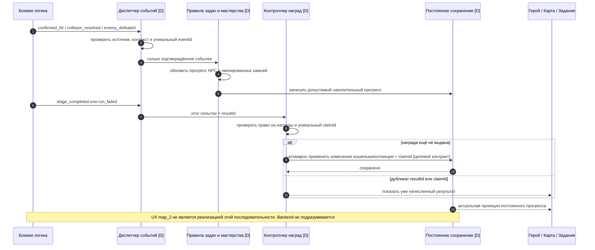
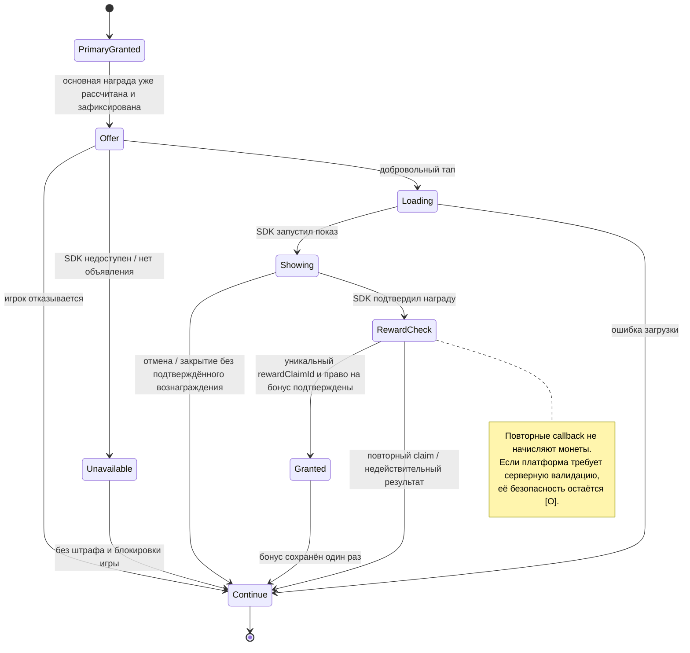
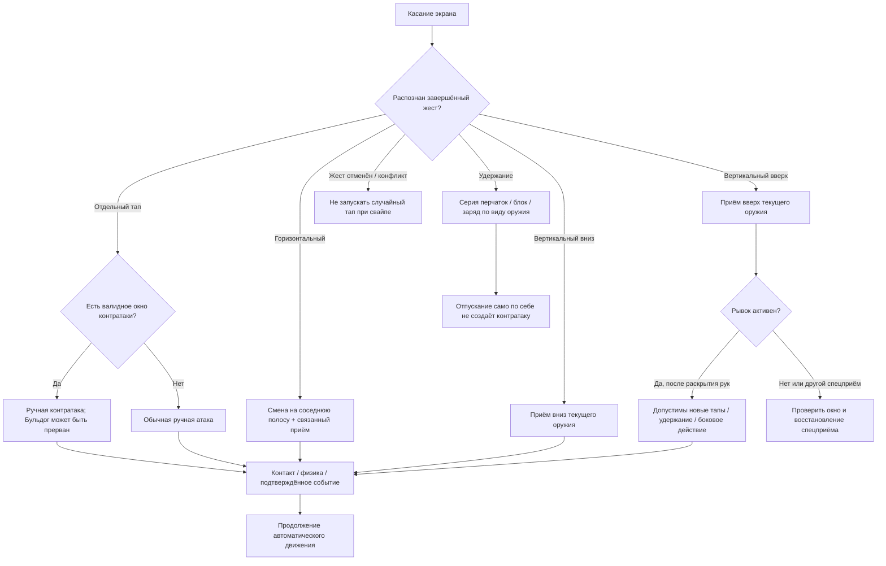
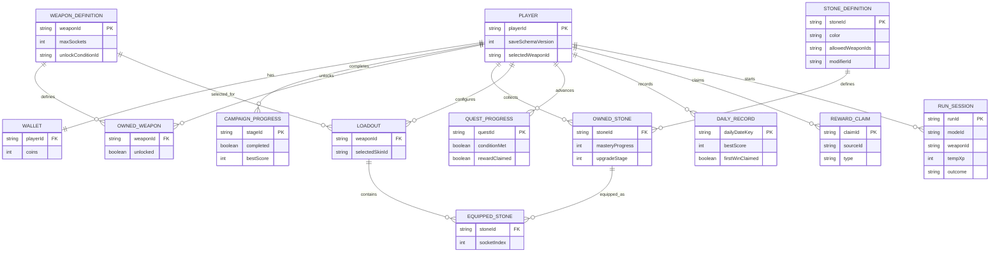
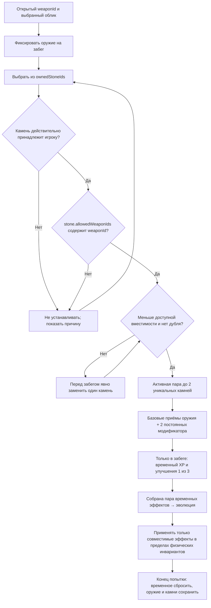
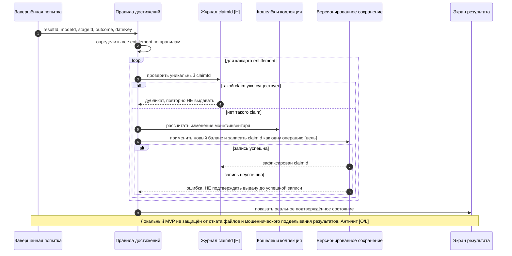

# PUNCH ’N’ GO — техническая спецификация

Реализованный Park Run и целевые системные контракты. [GDD](GDD.md) определяет поведение для игрока. Статусы [H/O] обозначают предложения и открытые решения.

[Указатель проекта](README.md)

<a name="park-run-v2"></a>

## Текущий Park Run v2 **[R]**

Проверочная версия — [`61bddd3`](https://github.com/artem-chinkov/punchngo-v2/commit/61bddd3). Боевой прототип содержит один забег с постепенно усложняющимися построениями и финалом с Бульдогом. Игровое время исключает паузы. Начало босса привязано ко времени, а не к дистанции. [Параметры сборки](BALANCE.md).

- Долгое комбо угасает при отсутствии новых ударов и сбрасывается при уроне. Обычный контакт корпуса передаёт импульс без XP или комбо. В активном таране живые цели подхватываются без повторных столкновений с героем.
- Бульдог останавливает продвижение тарана во всех полосах. Захваченные враги могут сохраняться при начале схватки. Вторая фаза добавляет обычных противников, а финальный нокаут замедляет сцену победы.
- Кнопка «В БОЙ!» после стартового обучения запускает отсчёт 3–2–1. Ситуационные подсказки идут в порядке жестов и не останавливают бой. Приём, который игрок уже выполнил самостоятельно, больше не подсказывается.
- Экран результатов показывает статистику, ранг, личный рекорд и повтор. Повтор получает новый seed и пустую временную сборку.

<a name="current-xp"></a>

### Выдача карточек XP в текущем билде **[R]**

[`Build.offer`](../src/game/upgrades.ts#L37) исключает карточки максимального ранга и «Второе дыхание» при полном HP. Из оставшихся вариантов формируется взвешенная выборка без повторов. Карточки уже выбранных семейств получают дополнительный вес. Предложение содержит до трёх карточек.

[`ParkRun`](../src/game/ParkRun.ts#L134) повышает уровень при достижении каждого порога. Пустое предложение пропускает окно и проверяет следующий достигнутый порог. При непустом наборе симуляция приостанавливается и после вступления игрок выбирает одну из выданных карточек новым касанием. Бой с Бульдогом прекращает выдачу. [TC-22](ACCEPTANCE.md#tc-22) сохраняет ожидаемый сценарий трёх карточек. Целевое правило при исчерпании пула открыто в [O-23](README.md#o-23). [Пороги и карточки](BALANCE.md#xp).

### Реализация боя, представления и сохранений

Серия удержания использует единый punch с явным PunchSource: tap, holdFirst или holdRepeat. Источник сохраняется в Strike и событии прямого попадания CombatEvent вместе с attackKind и hand. hold().dash остаётся true до acceptHold() после принятой атаки, включая промах; отказ по перезарядке не расходует первый удар. Отдельного счётчика серии в CombatSystem нет. Отложенный тап остаётся tap. Отпускание, свайп и существующие сбросы ввода не переносят серию на новое касание.

holdRepeatDamage = 0,8 применяется после усиления Build.damage только к прямому урону holdRepeat. DEV ограничивает коэффициент 0,5–1,0, NaN/Infinity используют 0,8. Общий hit/damage сохраняет комбо, огонь, XP и KO, импульс не меняется. Вторичные цепные события не наследуют PunchSource. Исходный интервал 0,25 с, улучшение частоты, замедление удержания и активный таран не изменены.

AttackMotion задаёт чистые визуальные профили. Джеб имеет амплитуду 0,75 и длительность не более 0,16 с против 0,23 с полноценного удара; след — 0,55 длины/непрозрачности, контактную вспышку — 0,6 размера и три луча вместо семи. Следы и вспышки живут 0,10 с; контакт рисуется только по реальному событию попадания. Боковая дуга показывает сторону перестроения, контратаки получают направленные акценты силы 1,3 / 1,6. Расчёт урона остаётся мгновенным, без ожидания пика анимации. Отмеченные промахи прямых/боковых ударов не создают прежнее кольцо контакта.

CombatView переиспользует один дополнительный Graphics на глубине 3,1: над кулаками и ниже предупреждений 3,5. Буфер частиц ограничен прежними 30 событиями; реакции по ID истекают через 0,8 с и очищаются при сбросе. Реакция регистрируется даже до появления render slot. Визуальный holdJabHitstop равен 0,022 с; обычный — 0,047, идеальный и воздушный — прежние 0,085. У живой цели джеб уменьшает наклон/деформацию при обычном отлёте до 55% и использует существующий мягкий flinch-кадр; координаты, скорость полёта, KO и позы AI не переписываются. Reduced motion сокращает след до минимальной отметки и число контактных лучей. Учебная серия использует tap → holdFirst → holdRepeat → holdRepeat.

Cue punch.jab_hit переиспользует три hit_light WAV с громкостью 0,35 и rate 1,15; обычный punch.hit остаётся 0,58. Лёгкий cue выбирается явно даже для громилы и Бульдога, остальные специальные и KO-звуки сохранены. Джеб входит в существующую группу impact с подавлением повторов чаще 45 мс, максимумом двух голосов группы и восьми общих. Новых аудиофайлов нет.

Phaser 4.2.1, TypeScript, Vite. Клиент без серверной зависимости. Симуляция на 60 Гц с ограничением накопленного времени и сбросом ввода при скрытии вкладки. ParkRun управляет фазами, Runner — положением камеры и движением, CombatSystem — уроном, опытом и счётом, EnemyAI — атаками, перестроением и Бульдогом. EncounterDirector и выбор улучшений используют независимые воспроизводимые генераторы на основе seed.

Положение задаётся в координатах полосы и расстоянием вдоль дороги. Камера сдвигается в координатах дорожки. Цели выбираются по логическим областям x/z, а столкновения цепочек учитывают движение за шаг и высоту. Импульсы, смерть, горение и очки обрабатываются симуляцией. Рендеринг читает снимок состояния и события, локальный hitstop действует только на позу пострадавшего.

TouchController распознаёт четыре свайпа, тап при отпускании и удержание с одним начальным рывком. Ручная контратака проверяется по текущему шагу и не ждёт интервала прямого удара. Супер-рывок и апперкот используют общий таймер спецприёмов; боковой удар разрешается только вместе с переходом. Runner интегрирует фазы подготовки, ускорения и затухания супер-рывка независимо от рывка тапа. Граница готовности обычных атак общая с анимацией: `superTiming().handsReady`. Ранний тап отклоняется без буферизации; удержание ждёт завершения выдвижения кулаков. Запрет повторного спецприёма проверяется в CombatSystem, без отложенного апперкота. EncounterDirector учитывает скорость прорыва для дистанции спавна. Отброшенный апперкотом противник летит по координатам мира; цепи проверяют пересечение тел с учётом высоты. Волна приземления срабатывает при переходе высоты через ноль.

Пружинный апперкот использует состояние Runner.uppercut с единственным возрастом, снимком нормализованного uppercutTiming, накопленным отступлением и флагами попадания/промаха. Общий uppercutFrame задаёт кулак, расширяющийся фронт, визуальное сжатие и затухание. Стандартные фазы: 0,10 с подготовки, 0,14 с выброса и восстановление до 0,55 с. Подготовка вычитает uppercutBrake = 8 из обычной скорости, не сбрасывая ход рывка тапа и замедления удержания. Отступление ограничено uppercutMaxRetreat = 0,3 фактически пройденного назад пути и z ≥ 0; при исчерпании бюджета отрицательное движение останавливается, но таймеры продолжают идти.

В выбросе добавка скорости линейно падает от P до 0,1P; P = 2 × uppercutLungeDistance / (1,1 × uppercutDrive). При стандартном пути 0,85 за 0,14 с P ≈ 11,04 ед./с. Остаток линейно затухает за 0,31 с и добавляет около 0,171 единицы. Runner интегрирует движение аналитически и сохраняет сегменты с границами фаз, переходами скорости через ноль и остановками у лимитов. Это позволяет проверить обратное и прямое движение внутри одного шага, даже при положительном итоговом перемещении. spawnSpeed исключает краткую добавку апперкота: расписание, seed и обычная дистанция появления не меняются. limitForward и кинематика DashPush не используются для отступления.

Во время выброса sweepGrowingBox проверяет движущуюся цель в полосе с растущим от 0 до uppercutReach = 4 фронтом; общий balance.reach остаётся 3,2. Полоса берётся из фактического x в момент пересечения, с разделением на границах полос при перестроении. За приём разрешено одно прямое попадание; промах выдаётся один раз после закрытия окна. В шагах апперкота атаки EnemyAI передаются со временем наступления и разрешаются вместе с контактом корпуса и попаданием по времени, с приоритетом опасных событий при равенстве. Это не добавляет защиту: атака, наступившая до попадания, наносит обычный урон; Бульдог сохраняет атаку и после прямого попадания. Новый полёт начинается из точки удара и продвигается за остаток шага, включая согласованную траекторию цели для цепных столкновений.

Паузы сохраняют возраст и бюджет отступления, поражение/финал/переходы DEV очищают состояние и ожидаемый удар. DEV допускает торможение 0–20, отступление 0–0,3, путь выброса 0–2 и дальность 1–8. Нормализация фаз оставляет минимум 0,02 с восстановления, ограничивает конечные значения диапазоном и заменяет NaN/Infinity стандартными. Визуальная дуга, пыль и сдвиг горизонта до четырёх логических пикселей не участвуют в уроне. Reduced motion отключает сдвиг камеры и декоративный след; учебный пример использует те же фазы без изменения симуляции.

DashPush — отдельная кинематическая система тарана в x/z: упорядоченные ссылки на Enemy, флаг `dashPushed`, признак единственного прямого попадания и наборы обработанных контактов/выбитых участников. Она не использует projectile Chain, chainTargets или chainDepth. Удалены устаревшие superTargets и superPush. Члены группы не исполняют обычный AI, не являются источниками цепного урона и не удаляются за камерой. Контакты героя и участников ищутся по swept-сегментам с детерминированным разрешением равенств по ID; после захвата пересчитывается остаток шага, поэтому группа подбирает следующие цели без лимита количества. Зазор до героя — 2,3, шаг ряда — 0,8; перестроения переносят цепочку вместе с героем, а пополнение и закрытие промежутков меняют координаты непрерывно. Боковое сведение ждёт продольного пространства.

CombatSystem сохраняет общий путь hit/damage для наград и улучшений. Прямой удар по удерживаемому врагу не вызывает impulse даже при KO; боковые удары и настоящие внешние столкновения снимают владение DashPush перед обычным импульсом. Электричество имеет отдельную ограниченную цепь эффектов и запускается только от первого попадания; низкий продольный полёт можно подхватить, боковые полёты и активные выбитые участники сохраняют физику. Контакты подготовки разрешаются до активной фазы. В активном шаге удары AI откладываются до разрешения захватов и упора: захваченный враг не атакует, босс остаётся опасным.

При окончании ускорения DashPush снимает владение без изменения координат и дополнительного воздействия. AI начинает обычное приближение и новую полную подготовку атаки, без возобновления старого таймера. Паузы сохраняют группу; поражение, финал и переходы DEV освобождают её. При штатном появлении босса захваченные враги сохраняются, босс размещается перед концом ряда. Во время тарана обычное подстраивание Бульдога под предполагаемую позицию камеры отключено: swept-контакт ограничивает фактическое продвижение через Runner.limitForward, сохраняя таймер скорости и исключая обход босса. Его фазы, атаки и контратаки остаются в EnemyAI.

Onboarding хранит отметки старта, контратаки и отдельных ситуационных подсказок отдельно от рекордов. В стартовом оверлее TutorialDemo и CombatView используют время интерфейса и общие траектории рук; движение камеры косметическое. ParkRun запоминает реального атакующего в первом подходящем жёлтом окне. ParkScene прекращает фиксированные шаги: после появления интерфейса отсчитывает 2,5 с видимого времени и ждёт отпускания всех старых касаний. TouchController отдельно хранит контакты и распознанные жесты, поэтому ранний pointerdown нельзя завершить поздним pointerup. Свежий тап передаётся в расчёт контрудара ровно один раз; пропуск переводит врага в восстановление без награды. TutorialOverlay размещается над существующим Canvas и HUD.

Asset Registry связывает процедурную графику и необязательные PNG/атласы с логическими идентификаторами и точками опоры. ParkView повторно использует декорации, CombatView — визуальные представления врагов. DOM HUD показывает состояния меню, боя, повышения уровня и итогов. Рекорды хранятся в localStorage с ключом v2. DEV включается через `?debug=1` на локальной сборке.

Вне активного тарана CombatSystem проверяет встречи корпуса по пересечению относительных траекторий. Враг получает импульс из точки встречи и смещается за остаток шага; у камеры минимальная боковая коррекция освобождает путь без изменения координат героя. Повторный контакт требует разделения и завершения окна защиты. Толчки корпусом используют ограниченную цепочку переноса импульса без урона; уже летящие от удара враги могут разойтись с героем без повторной травмы и сохраняют цепочку. За камерой физика отлёта работает до завершения полёта.

Аудиомодуль получает одноразовые сигналы от симуляции и переключает музыку по фазам забега. Источник файлов и громкости — [`audio_manifest.json`](../src/audio/audio_manifest.json); игровые MP3 и WAV лежат в `public/assets/audio/`. Браузер разблокирует звук по действию игрока; настройки сохраняются отдельно от рекордов. При скрытии вкладки музыка ставится на паузу, короткие звуки прекращаются. Свист супер-рывка привязан к активной фазе ускорения и отключается на паузе, при выключении эффектов и при завершении забега.

V2 — независимая локальная копия истории v1. GitHub Actions запускает тесты и сборку v2, а при обновлении основной ветки публикует только `dist/` на GitHub Pages. Окружение и WebGL проверяются отдельно; параметр `?renderer=auto` выбирает Phaser AUTO, стандартный режим — Canvas.

### Основные модули прототипа **[R]**

| Модуль | Назначение |
|---|---|
| [`src/game/ParkRun.ts`](../src/game/ParkRun.ts) | Фазы забега, босс, улучшения, завершение |
| [`src/game/Runner.ts`](../src/game/Runner.ts) | Полосы, рывки, профиль апперкота |
| [`src/combat/CombatSystem.ts`](../src/combat/CombatSystem.ts) | Ручные атаки, урон, контратаки, KO, XP |
| [`src/combat/EnemyAI.ts`](../src/combat/EnemyAI.ts) | AI и фазы босса |
| [`src/combat/DashPush.ts`](../src/combat/DashPush.ts) | Толкаемая цепочка врагов |
| [`src/game/EncounterDirector.ts`](../src/game/EncounterDirector.ts) | Построения волн |
| [`src/rendering/CombatView.ts`](../src/rendering/CombatView.ts) | Бой, руки, попадания, эффекты |
| [`src/rendering/ParkView.ts`](../src/rendering/ParkView.ts) / [`PerspectiveProjector.ts`](../src/rendering/PerspectiveProjector.ts) | Дорога и проекция |
| [`src/game/Onboarding.ts`](../src/game/Onboarding.ts) | Текущее обучение |
| [`src/game/records.ts`](../src/game/records.ts) | Локальная статистика |
| [`src/debug/BalancePanel.ts`](../src/debug/BalancePanel.ts) | DEV-баланс |

<a name="runtime-budgets"></a>

### Технические бюджеты и проверки

| Показатель | Текущая граница / статус | Источник |
|---|---|---|
| Шаг симуляции | 60 Гц [R] | [FrameClock](../src/game/FrameClock.ts) |
| Буфер эффектов попадания | 30 событий [R] | [CombatView](../src/rendering/CombatView.ts) |
| Одновременные голоса звука | 8 общих, до 2 ударных [R] | [Аудиоконфигурация](../src/audio/audio_manifest.json) |
| Целевое время кадра на телефонах | Числовой порог не зафиксирован. При замере записывать устройство, браузер, рендерер и сцену. | [DEV и запуск на телефоне](../README.md) |
| Экраны для проверки UX | 320×568, современные iPhone и Android [D] | [UX-проверки](ACCEPTANCE.md#ux-matrix) |

## Целевые подсистемы **[D/H/O]**

- Декларативные `zoneId`/`stageId`, вид задачи, события/сценарий, босс и награды. Уровень 4-1 не должен требовать копирования всей боевой сцены.
- События `enemy_defeated`, `confirmed_hit`, `collision_resolved`, `counter_success`, `objective_progress`, `stage_completed`, `run_failed`, `daily_completed`, `ad_reward_confirmed` — единственный источник продвижения NPC и мастерства, без переисполнения логики физики.
- Постоянное состояние [D по составу данных, H/O по полям, схеме и хранению]: `currency`, `campaignProgress`, `unlockedWeapons`, `ownedStones`, `stoneMastery`, `stoneLevel`, `selectedWeapon`, `equippedStoneIdsByWeapon`, `ownedSkins`, `npcQuests`, `dailyRewardLedger`, `records`. Данные сериализуются с версией схемы и миграциями.
- Контент камня: `stoneId`, `color`, `allowedWeaponIds`, `mechanicalEffectId`, `upgradeStages`, `masteryRequirement`, `coinCost`, `visualState`; у оружия `maxSockets`, `compatibleStoneIds` и варианты арта. Не хардкодить уникальные правила через UI-кнопки.
- Ежедневный режим: детерминированная конфигурация по `dateKey + rulesetVersion + seed` [D как целевой принцип]. Для реальной мировой таблицы необходимо серверное время/валидация результата. `map_2` только симулирует данные и переход дней.
- Предлагаемый [H/O] `AdService` и платформенные адаптеры, включая условный NullAd в UX-прототипе. Вознаграждение начислять **после callback SDK**, только один раз на уникальный результат/показ; не при одном лишь клике.
- Для мобильных магазинов нативный рекламный SDK может требовать мост/нативную оболочку; Phaser веб-страница не является сама по себе нативным рекламным SDK [O].

<a name="diagram-9"></a>

#### Диаграмма 9. Последовательность игровых событий и сохранения прогресса **[D как целевая архитектура]**

Это **архитектурное требование к будущему игровому клиенту**, а не описание уже реализованной системы из UX-демо `map_2`.



**Правило:** `map_2` сейчас только симулирует события и хранит UI-демосостояние отдельно. Реальный прогресс требует проверки выдачи наград, миграций сохранений и защиты от повторного начисления.

<a name="diagram-10"></a>

#### Диаграмма 10. Состояния добровольной рекламы и выдачи бонуса **[D как правило; интеграция O]**

Диаграмма описывает желаемое поведение независимо от рекламной сети; фактические callback и договорные условия требуют проверки перед реализацией.



**Правило:** никакой рекламы посреди боя или обязательного просмотра ради сюжета. Награда выдаётся только после подтверждения рекламной платформы и проверки уникальности результата.

<a name="ux-boundary"></a>

### Жёсткая граница UX-прототипа **[D]**

`map_2` — автономный статический HTML/CSS/JS UX-прототип, не полноценная симуляция Phaser и не серверный продукт. Никаких живых IAP, платежей, рекламы, глобального рейтинга или записи в данные `punchngo-v2`. Макеты должны быть интерактивными в части переключения оружия/камней/обликов, модальных окон и демонстрационного игрового дня, но **не изображать реальные покупки и онлайн-позиции без пометки DEMO**.

| ID | Инвариант | Статус |
|---|---|---|
| <a name="inv-19"></a>`INV-19` | Рейтинг `map_2` всегда имеет явную пометку DEMO. Реальных глобальных позиций, аккаунтов и anti-cheat там нет. | [D] |

## Сущности, состояния и конфигурация

### Ключевые сущности и терминология

| Термин | Операционное значение | Область жизни | Статус |
|---|---|---|---|
| `RunSession` / попытка | Один старт конкретного сюжетного или ежедневного забега с единственным исходом `won`/`failed` | Одна попытка | [D]; имя структуры [H] |
| `stageId` | `0-1` и `1-1..4-3`, всего 13 узлов (12 сюжетных + обучение) | Постоянная конфигурация | [D] |
| `weaponId` | Выбранное на попытку оружие: перчатки, меч/щит, посох, молот | Постоянное с фиксацией при старте | [D] |
| `stoneId` | Идентификатор уникального модификатора оружия, **не** единица валюты | Постоянный предмет | [D] |
| `equippedStoneIds` | Набор совместимых камней выбранного оружия, максимум 2 активных в MVP | Сборка до попытки | [D] |
| `masteryProgress` | Подтверждённые события для условия пробуждения конкретного камня | Постоянное | [D]; пороги [H/O] |
| `stoneStage` | Уровень пробуждения камня; базовая и пробуждённая ступени для теста | Постоянное | [H] число стадий |
| `RunXP` / XP | Опыт только за KO. В Park Run непустое предложение карточек вызывает паузу | Только одна попытка | [R] |
| `TemporaryUpgrade` | Временная карточка и её ранг; активна до конца попытки | Только одна попытка | [R] |
| `Evolution` | Результат совместимой пары временных улучшений | Только одна попытка | [D]; рецепты [H] |
| `coins` | Единственная основная постоянная валюта | Постоянное | [D] |
| `score` | Очки попытки/рекорда, не трата и не монеты | Одна попытка + лучшие значения | [R/D] |
| `dailyDateKey` | Единый идентификатор игрового дня в определённой временной зоне | День / рекорд / награда | [D] единство; реализация [O] |
| `claimId` | Однозначный ключ конкретной выдачи награды, предотвращает повторный grant | Постоянный журнал | [H] инженерный способ исполнить [D] |
| `map_2` | Отдельный интерактивный UX-демопрототип, **не** источник производственных наград | Отдельный проект | [R-UX] файлы в GitHub; не бой |

<a name="save-lifecycle"></a>

### Жизненные циклы и граница сохранения

| Объект | На старте попытки | При поражении | При победе | После перезапуска приложения |
|---|---|---|---|---|
| HP и активные способности | Устанавливаются из правил оружия/камней | Уничтожить текущую попытку | Попытка завершается | Не восстанавливать старый бой, если нет отдельного решения [O] |
| XP/карточки/эволюции | Пустая временная сборка | Сбросить | Сбросить | Не сохранять как постоянную силу |
| Результат/очки | Счёт начинается заново | Зафиксировать неуспешный исход | Сохранить лучший при новом рекорде | Сохранить исторический рекорд |
| Прогресс NPC/мастерства | Считать по подтверждённым событиям | Сохранить допустимый накопительный прогресс | Сохранить | Восстановить из постоянных данных |
| Сюжетные основные цели текущего забега | Инициализировать заново | Сбросить незавершённую цель | Продвинуть сюжет при полном условии | Сохранить только пройденные уровни |
| Монеты/коллекция/огранка | Загрузить перед выбором сборки | Изменить только при разрешённом начислении | Применить только подтверждённые транзакции | Восстановить последнее подтверждённое состояние |
| Итог дня/лучший счёт/погашенные награды | Загрузить по `dailyDateKey` | Не аннулировать предыдущие победы | Обновить один раз по правилам | Не терять entitlement за текущий день |

**Важная граница [O]:** точный момент фиксации накопительного NPC/мастерства во время долгой попытки, стратегия сохранений при принудительном завершении приложения, миграции и защита от отката локального кошелька ещё не утверждены. Целевой принцип — не терять уже подтверждённые события, но нельзя обещать абсолютную надёжность без выбранной платформы хранения.

### Декларативная конфигурация вместо зашитых в UI правил

Для каждого `StageDefinition` должны существовать `stageId`, `zoneId`, `objectiveId`, `bossId` (если есть), `winConditions`, `failConditions`, `rewards`, `npcUnlocks` и `contentVersion` **[H — предлагаемый формат]**. Для `StoneDefinition` — `stoneId`, `color`, `allowedWeaponIds`, `modifierId`, `masteryCondition`, `upgradeStages` и `visualId`. Для `DailyDefinition` — `dailyDateKey`, `rulesetVersion`, `seed`, `modifiers`, `scoringRules` и `rewards` **[H]**.

**Не копировать имена структур буквально в проект, пока не проведена сверка с актуальными TypeScript-типами.** Названия полей — контракт смысловой полноты, а не утверждённый API. Любой закрытый `[O]` фиксируется явно, а не заполняется правдоподобным дефолтом.

## Дополнительные технические и геймплейные диаграммы

<a name="diagram-11"></a>

### Диаграмма 11. Приоритеты ввода и пересечение боевых действий **[R/D; детали нового оружия H/O]**

Система ввода — **арбитр жестов, а не автомат-комбо, исключающий параллельные действия**. Например, во время активного тарана после раскрытия рук могут снова быть доступны ручные удары и боковые перестроения. Контратака требует отдельного точного тапа; удержание не превращается в контратаку. Временные интервалы описаны в § 4–5; новые приёмы оружий пока `[H/O]`.



**Инварианты графа:** жест никогда не должен одновременно порождать «свайп» и «случайный тап»; завершение удержания не выдаёт бесплатную контратаку; приоритет предупреждений опасной атаки над эффектами — обязательное UX-правило. Приоритеты одновременных событий конкретных оружий — `[O-13]`.

<a name="diagram-12"></a>

### Диаграмма 12. Модель постоянных и временных данных **[D как смысл; имена и связи хранения H]**

Это **концептуальная ER-модель**, а не утверждённая SQL-база. В текущем локальном MVP допустима сериализованная структура с версией схемы. `OwnedStone` — собственность игрока и развитие камня, `EquippedStone` — выбор в сборке для конкретного оружия, `RunSession` — временные данные, `RewardClaim` — факт уже выданной награды.



**Ограничения модели:** PK в концептуальной таблице может быть составным (`playerId + stageId` и т. п.). `RUN_SESSION` представлен в ER для связности, **но временный XP нельзя превращать в постоянный бонус**. Формат перечисления совместимых оружий в `STONE_DEFINITION` — временная запись; при дальнейшем масштабировании он может стать отдельной связью many-to-many. Универсальные камни и 3-й слот — `[L]`.

<a name="diagram-13"></a>

### Диаграмма 13. Слои модификации оружия и проверка совместимости **[D; эффекты H]**



| Пара | Порядок проверки перед активацией | Принцип конфликта |
|---|---|---|
| Камень + базовое действие | `owned` → совместимость → доступное гнездо → подтверждённый ввод | Новый эффект не заменяет обязательное ручное управление [D] |
| Два постоянных камня | Проверить совместимость обоих с **одним** видом оружия | При конфликте приоритетов или траекторий правило отсутствует `[O]`, **не складывать эффекты автоматически** |
| Камень + временная карточка | Подтверждённое событие на одной физической цели | Простой захват цепочки не вызывает дополнительный урон [D/R] |
| Камень + эволюция | Сначала определить события и лимиты столкновений, потом VFX/множители | Телеграф босса важнее VFX; автоматическая отмена опасного выпада запрещена [D] |
| Несколько источников очков/XP | KO и столкновения имеют разные триггеры и уникальные ID | Не удваивать награды от одного события [R/D] |

**Предположения:** сочетания 3 камней перчаток в прототипе — красный+синий, красный+зелёный, синий+зелёный; это **три варианта экипировки**, не отдельные предсозданные классы. Для MVP тестировать все три и их пересечения с двумя временными эволюциями до производства остальных девяти камней.

<a name="diagram-14"></a>

### Диаграмма 14. Контракт идемпотентной выдачи наград **[D по однократности; техническая транзакция H/O]**



**Примеры семантики ключей [H]:**

| Награда | Ключ однократности | Повторная попытка |
|---|---|---|
| Первое прохождение уровня | `firstClear:<stageId>` | Нет повторного бонуса первого прохождения |
| Обычная выплата за **каждую** победу/поражение | `runReward:<resultId>` | **Да**, новый `resultId` — новая законная награда; старый ID нельзя переиспользовать |
| Уникальный камень от NPC | `npc:<questId>:stone:<stoneId>` | Не выдавать повторно даже при повторном открытии диалога |
| Первая победа в испытании дня | `daily:<dateKey>:firstWin` | Не выдавать повторно в тот же день; на следующий `dateKey` возможна снова |
| Календарный рубеж косметики | `dailyMilestone:<threshold>` | Только один раз за число разных успешных дней [H/O] |
| Rewarded-реклама после результата | `ad:<resultId>:<placementId>` | Не больше одного бонуса за допустимый результат и размещение [H как ключ, лимит [D]] |
| Огранка камня | `stoneUpgrade:<stoneId>:<newStage>` | Списание монет и повышение стадии единожды |

Отдельно различать **прогресс**, **право на награду**, **начисление**, **подтверждённую запись** и **визуальное уведомление**. Вызов `UI.showSuccess()` до сохранения экономической транзакции запрещён как целевое правило надёжности [H]. Никакой реальный backend, антимошенническая защита и синхронизация здесь не подразумеваются.

<a name="events"></a>

## Контракт обработки событий и результатов

### Типы событий и последствия

| Событие / условный eventType | Кто производит / подтверждает | Что допускается изменить | Что запрещено менять | Статус |
|---|---|---|---|---|
| `confirmed_hit` | Боевая логика при реальном контакте | Режимы камней, hit-based NPC/комбо при корректном условии | XP за один только hit, двойной урон | [R как факт попадания; тип H] |
| `collision_resolved` | Физический движок после реального столкновения | Очки и мастерство подходящих камней/задач | XP за столкновение без KO; повторная цепная выплата | [R/D; событие H] |
| `enemy_defeated` | HP врага пересекло 0 единожды | XP, очки за KO, счётчик побеждённых | Повторное начисление за того же врага | [R/D] |
| `counter_success` | Точный ручной ввод в допустимом окне | Прервать опасный выпад босса, контрурон, мастерство | Автоматически засчитывать удержание | [R/D] |
| `objective_progress` | Директор цели после валидного действия | Прогресс основной цели **только текущей попытки**, подходящий NPC-прогресс | Постоянно разблокировать сюжет без победы | [D; API H] |
| `run_failed` | HP <= 0 или другое утверждённое условие поражения | Завершить попытку; допустимый накопительный прогресс | Контрольная точка, автоматическое возрождение | [D] |
| `stage_completed` | Основная цель и финальное условие выполнены | Результат, монеты, новый узел, оружие при нужном боссе | Открыть следующую зону по частичной цели | [D] |
| `stone_upgraded` | Явное действие игрока и проверка условий | Списать монеты + повысить камень одной операцией | Изменять XP, возвращать уже оплаченный этап | [D; транзакция H] |
| `daily_completed` | Победа в ежедневном забеге | Лучший результат, мастерство, денежный entitlement дня | Второй раз выплатить полную монетную награду | [D] |
| `ad_reward_confirmed` | SDK callback / валидация конкретной сети | Только разрешённый рекламный бонус | Перезапускать основное начисление за результат | [D; интеграция O] |

**Единый источник правды:** прогресс накопительных задач должен обновляться по **доменным игровым событиям**, а не по UI-анимациям/сообщениям, которые можно повторить. Иначе повторный вход в модалку NPC способен выдать награду снова.

### Envelope события и корреляция **[H, предлагаемая структура]**

```json
{
  "eventId": "unique-within-profile",
  "runId": "unique-attempt-id",
  "eventType": "collision_resolved",
  "occurredAtTick": 4821,
  "sourceEntityId": "enemy-12",
  "targetEntityId": "enemy-14",
  "weaponId": "gloves",
  "equippedStoneIds": ["gloves-red", "gloves-green"],
  "modeId": "story",
  "stageId": "1-2",
  "rulesetVersion": "prototype-revision"
}
```

Эта JSON-структура **не является реальным TypeScript-кодом или утверждённым форматом**. Поля показывают, какая информация нужна для воспроизводимой проверки события; названия, типы, ограничения клиентского доверия и временные метки сверить с актуальным репозиторием перед реализацией `[O]`.

### Детерминизм и антидубли

- **Награды [D, ключ `claimId` — H]:** уникальность `claimId` относится к предмету/валютной выплате, а не только к клику на кнопку. Повторная доставка одного и того же события должна приводить к тому же состоянию.
- **Бой:** расчёт столкновения должен производить событие только после реальной физической проверки. Дубли из рендера, повторной анимации нокаута или callback не могут повторять XP/награду.
- **День:** `dailyDateKey` определяется одним согласованным источником времени. До выбора реального кроссплатформенного времени и защиты локальные даты не годятся для честного мирового рейтинга `[O/L]`.
- **Поражение:** разрешённые события мастерства и NPC могут сохраниться, но сюжетная цель попытки не должна остаться «наполовину пройденной» после новой попытки.
- **Сбой записи:** нельзя одновременно считать награду выданной в UI и не записать кошелёк. Как обеспечивать атомарность и восстановление — `[O]` для производства, прототип может имитировать.

### Категории данных сохранения **[D семантика; механизм O]**

| Постоянное | Временное | Будущее серверное `[L/O]` |
|---|---|---|
| Пройденные уровни, открытое оружие, камни, облики | HP, положение на дороге, активные враги | Проверенные глобальные таблицы результатов |
| Количество монет и история однократных наград | XP, выбранные карточки и временные эволюции | Общий аккаунт и межустройственная синхронизация |
| Камни в гнёздах, стадии и мастерство | Текущая цель в незавершённой попытке | Серверные правила календарного дня и античит |
| NPC-статус и подтверждённые награды | Временные боевые таймеры и телеграфы | Возможный веб-магазин и права на IAP (только при отдельном решении) |
| Личные рекорды и отметки ежедневных наград | Текущие анимации и VFX | Сверка наград по доверенному времени |

## Аналитика и целостность выплат

Измерять: источники/траты монет по типам, время до первой огранки, процент пользователей со вторым гнездом, долю камней по оружиям, частоту перестановки сборки, долю выполненных NPC-квестов, время до открытия 4-й зоны, долю возвращений к ежедневному режиму, накопленные победы, выбор косметики, долю добровольных Rewarded Ads, ARPDAU/LTV по платформам после подключения рекламы.

Нужные события: `stone_owned`, `stone_equipped`, `stone_unequipped`, `stone_mastery_progress`, `stone_upgraded`, `coin_earned`, `coin_spent`, `npc_reward_claimed`, `daily_started`, `daily_completed`, `daily_reward_claimed`, `daily_invite_dismissed`, `personal_record_updated`, `ad_reward_granted`. Не считать событийную схему уже внедрённой; MVP-аналитика и хранение — [O].

Антиабуз: уникальные claim ID, отсутствие повторного начисления после повторного результата, один дневной денежный бонус, контроль выполнения challenge по подтверждённому событию, учёт источника рекламного callback. Серверная защита глобальных результатов — [L].

### Платформенные материалы

- Apple Human Interface Guidelines — Sheets: https://developer.apple.com/design/human-interface-guidelines/sheets . Уместность контекстных модальных панелей, сохранение связи с основным экраном.
- Yandex Games SDK — Advertising: https://yandex.com/dev/games/doc/en/sdk/sdk-adv . Выдача Rewarded Video по подтверждённому `onRewarded`, показ рекламы в естественных паузах.
- Google Play Console — закрытое тестирование новых личных аккаунтов: https://support.google.com/googleplay/android-developer/answer/14151465 . Минимум 12 участников в течение 14 непрерывных дней для соответствующих аккаунтов перед заявкой на Production.

Сверять актуальные требования площадок перед публикацией и подключением рекламы.
